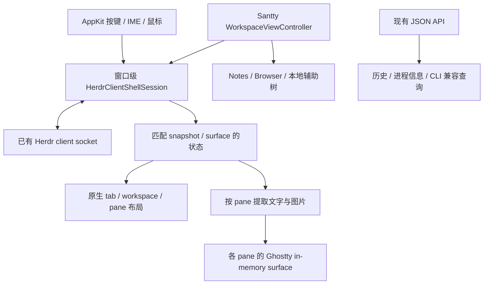

# Santty 迁移到 Herdr 常规 ClientShell 协议的实施计划

日期：2026-10-11；静态调查更新：2026-10-12。状态：基础实现与部分原生窗口、语义输入接线已存在；完整迁移尚未完成。本轮按用户要求暂停实现和验证，仅调查常规客户端源码并制定后续计划。

最初调查和规划轮没有连接真实服务或运行验证。用户随后要求完整实现，现已开始实施；完成证据与剩余工作见 [实施记录](herdr-clientshell-progress.md)。下文的阶段验收要求不能视为已经全部通过。

本次追加要求为“先调查常规客户端实现并制定计划，不验证”。本轮只复核本地 pinned 源码并补充设计，不运行 build/test、不连接真实服务，也不继续修改应用代码。已有基础实现及其历史验证记录保留，不能据此把窗口级迁移视为完成。

## 结论与关键决策

可以采用 Herdr 常规客户端相同的 ClientShell endpoint 协议，同时保留 Santty 原生界面。复用的是客户端与服务端之间的状态、surface、输入及命令合约；Herdr 的 TUI、prefix 快捷键和客户端进程不需要嵌入 Santty。

迁移单位是完整窗口，不是给旧的 per-pane attach 通道补一个图片开关。一个持久连接接收整个当前 tab 的权威布局与图片场景，再分发到各 Ghostty surface；选中状态和输入目标必须与同一 revision 的画面一起提交。这同时消除切换操作启动 fish/Herdr 子进程的路径，但服务端处理和呈现延迟仍需后续测量，不能在本轮宣称已解决。

必须接受两项边界：激活 ClientShell 会参与服务端尺寸控制，不能作为真正只读观察；浮动后端 pane 保持原 tab 中的逻辑 grid，第一版使用裁剪/留白，不独立调整其 PTY 尺寸。本地 Notes、Browser、辅助终端仍由 Santty 管理。

## 1. 目标与范围

完整窗口 Herdr 模式改用常规客户端的 ClientShell endpoint 协议，接收完整文字及图片场景，并继续使用 Santty 原生 tab、pane、workspace 下拉、菜单和快捷键。Herdr 继续由用户独立运行，Santty 只连接已有服务；不安装、启动、升级或修改 Herdr。

保留现有本地 Terminal、Notes、Browser、辅助分屏、浮动、隐藏、自动放大以及 Leave Herdr Mode 后恢复本地工作区的能力。图片首次连接、切换 tab 和重连恢复属于此次迁移的核心目标。

此次主线是本地完整窗口 Control 模式。旧单 pane direct 接入和真正只读的 Observe 暂时保留现有通道，明确其图片限制；不能把禁止键盘输入的 ClientShell 冒充只读连接，因为激活 surface 本身会影响前台身份和尺寸。SSH 延续用户“暂时跳过”的决定，不列入本次交付要求。

该计划替代[原实施计划](herdr-native-client.md)中完整窗口 Control 模式的通信、尺寸、同步与输入设计；原计划的本地功能、生命周期和数据保护要求继续有效。之前完成的阶段不重做，不把本次迁移记为旧阶段已经具备的能力。

## 2. 调查基线和常规客户端工作方式

源码基线：Herdr 0.9.3，提交 `2563803dca97c040beaf3dc3acdcb5a3221b4238`。本地调查副本为 `/tmp/santty-herdr-research`。前两轮真实图片证据见[图片调查](herdr-images-investigation.md)。

### 2.1 连接与兼容边界

- 常规客户端在 `client/mod.rs::run_client_with_mode` 中以 `attach_request.is_none()` 选择 client-rendered shell。
- `client/handshake.rs::do_handshake` 使用 `ClientMessage::EndpointControl`，kind 为 `endpoint.hello.v1`，接收 `endpoint.welcome.v1`。
- generation 为 1，协商 `shell.snapshot.v1`、`shell.surface.v1`、`shell.input.semantic.v1`、`shell.blob.v1`，再依据 welcome 的 methods/capabilities 启用附加功能。兼容判断不要求 Herdr 构建版本相同。
- 底层仍是 client socket 上的二进制帧：4-byte little-endian 长度，加 bincode 2 standard payload。命名 control 中的 data 是 JSON；surface、输入、响应 chunk 等仍使用冻结的二进制布局。它不是可直接用 JSON socket API 替代的协议。
- 常规客户端把读写放在独立 worker 上，带连接 generation、有限队列、部分读写进度与取消。写队列满属于连接故障，不能悄悄丢掉输入或重发已经部分写出的消息。

### 2.2 snapshot、surface 与命令

- `ClientShellSnapshot` 提供 workspace/tab/pane、选中目标及其他 UI 元数据。
- `PaneSurfaceFrame` 是当前 tab 的内容 surface，不含客户端 sidebar/tab bar；包含 `FrameData`、各 pane 的 `rect/inner_rect`、scrollbar、分隔线、popup 和 `SurfaceGraphicsScene`。
- snapshot 与 surface 通过 `boot_id`、`projection_revision` 关联，完整和增量 surface 还带 `surface_revision`。普通客户端会等待匹配的 snapshot/surface，隔离未来帧并拒绝旧帧，而不是收到哪条消息就立即替换 UI。
- `PaneSurfacePatch` 必须匹配 `base_surface_revision`，下一 revision 严格递增；需要验证所有 row 范围及 pane geometry 后再提交。
- 命令通过同一连接的 `ClientShellEndpointRequest { boot_id, request }` 发出，响应按 request ID 分块。服务端每个 endpoint 同时只允许一个普通命令在途，否则返回 `endpoint_busy`。
- `workspace.focus`、`tab.focus`、`pane.focus`、布局修改、创建/关闭等应走 endpoint 命令通道。继续用全局 JSON API 驱动这些操作，会绕开客户端自己的 projection/location 语义。

### 2.3 图片不是一条附加 ANSI 流

- 服务端 `client_shell::render_at` 收集当前场景的图片，`SurfaceGraphicsScene` 包含完整 desired placements、此次新传输的 assets 和 retained assets。
- asset key 包含来源 pane/popup、image ID、尺寸、RGB/RGBA/PNG 格式、长度和 fingerprint；相同原始 image ID 在不同 pane 中不是同一图片。
- placement 包含位置、行列跨度、源图裁剪区域、像素 offset、z 和 scrollback offset。普通 pane 的 placement 坐标落在 tab surface 中，提取到独立 pane 时需减去其 `inner_rect` 原点；popup 使用独立坐标空间。
- 常规客户端用 `kitty_graphics::surface::ClientState` 保留资产，计算当前 desired scene、删除失效图片，并生成宿主 Kitty graphics 命令。图片资产并不保证在每张完整 surface 中重复出现。
- `direct_graphics` 是本地共享文件上传优化，不是“开启图片”的总开关。关闭它时服务端会 materialize 图片资产并通过 surface 内联发送。第一版使用这条路径，可避免文件所有权与 GraphicsFile ACK/retirement 的额外复杂度。

### 2.4 输入由服务端按实际程序状态编码

常规客户端先消耗自己的 UI 快捷键，再发送 `ClientShellPaneInput` 或 `ClientShellPopupInput`。事件包括语义 Key、TextCommit、Paste 和 Mouse；Key 带 press/repeat/release、修饰键和文本信息。服务端根据 pane 程序协商的键盘协议编码到 PTY。

当前 Santty 的 `InMemoryTerminalSession.write` 收到的是 Ghostty 已经编码的 bytes。这不能直接等同于语义输入，也不应通过猜测 ESC 序列反推按键。迁移需要在 AppKit 事件和 IME commit 层接入，Ghostty 的本地协议回复单独消费。

### 2.5 尺寸、前台身份与生命周期

- ClientShell 使用整个 tab 的 `ClientShellResize`，带统一 cell pixel size。服务端据此计算 pane 几何和 PTY 尺寸。
- `surface_active=false` 是 metadata-only 状态，不提供图片 surface。激活 surface 会参与前台和 tab geometry 管理。
- `client_views.rs` 维护每 tab 的 geometry controller；多个交互操作会取得 geometry ownership。只有一个 active shell client 时，源码会按其尺寸调整所有 tabs；多个客户端时按目标 tab 处理。因此不能承诺 ClientShell 与旧 direct controller 一样具有单 pane 的独立尺寸控制。
- 普通客户端的激活顺序为 resize → `client_shell.surface.set(active:true)` → host focus，等激活响应及匹配的 snapshot/surface 后才提交显示并开放输入。
- endpoint 的 health check、presentation-effects fence、surface interest 都有能力协商，不能假设所有 generation-1 服务都支持新扩展。

## 3. 采用的架构

每个完整窗口、每个正在使用的 endpoint 只建立一个 ClientShell 连接；该连接承载当前 tab 的全部 pane。切 tab/workspace 使用持久连接上的 endpoint 请求，不启动 `herdr` 子进程，不运行 fish，不逐 pane 重建连接。

实现采用 Swift 和现有 Unix socket 设施，覆盖实际使用的 generation-1 wire 合约；不嵌入 Herdr TUI，不引入 Rust bridge 或通用 multiplexer SDK。若复用上游代码或 fixtures，记录 pinned revision 并保留 Apache-2.0 归属说明。

JSON 管理通道保留在协议未提供的历史、进程信息、Santty CLI 和只读布局拓扑查询中；它不能覆盖完整窗口的选中目标或 surface 的权威可见几何。非当前 tab 没有实时 surface，只有 metadata 和本地缓存；切过去后由新 surface 更新，不能显示为实时画面。

## 4. 协议实现决策

### 4.1 首版协商

| 项目 | 决策 |
| --- | --- |
| generation/codecs | generation 1，支持四个必需 codec；不匹配时明确拒绝 |
| `endpoint_keybindings` | false，保留 Santty Command 快捷键，不引入 Herdr prefix |
| `direct_graphics` | false，接收 surface 内联资产；暂不实现共享文件优化 |
| `surface_active` | 具备 `surface_interest` 时以 inactive 建连，元数据就绪后按序激活；缺失该能力时拒绝新 ClientShell 模式并提供显式旧模式入口 |
| `pixel_mouse` | 只有取得一致的 cell 与 pane 像素尺寸时为 true |
| `surface_reuse/delta/scroll` | 首轮关闭；基础 full surface 与 PaneSurfacePatch 正确后再分项启用 |
| 未知 named control/JSON 字段 | 忽略兼容扩展；必需 codec 或已知消息内容不合法则断开 |
| 未知二进制 variant | 不猜测其字段结构，结束该连接并给出兼容性错误 |

`shell.blob.v1` 是协商中的 codec 名，不能据此虚构新的 blob.get API。按 wire 中的实际消息、surface assets、响应 chunks 和所启用能力实现。

### 4.2 状态与原子提交

一个 session 保存连接 generation、boot ID、snapshot revision、surface baseline、请求队列和图片资产 cache。socket decode 在后台顺序执行；AppKit 投影及 controller 生命周期在 `@MainActor`。

提交规则：

1. boot ID 改变时丢弃旧请求、画面、图片、命中区域和输入路由，重新建立一致状态；不能仅凭 pane ID 重用旧运行时绑定。
2. 可交互画面必须有同 boot、同 projection revision 的 snapshot/surface，尺寸与当前激活请求相符。未来 surface 有界暂存，过时消息拒绝；缺失匹配状态超过超时则重连。
3. Patch 必须匹配基线且所有更新合法；先校验后修改，不能应用半张 patch。
4. 本地布局、焦点和 tab 选择立即按 Local 模式响应，再合并尚未发送的同步请求；旧回传不能覆盖最新本地意图。远端输入仍等待匹配的 snapshot/surface 和图文提交，不能跨切换排队到未知 pane。新建、关闭及后端重排等生命周期操作仍等待后端完成。
5. 命令响应只表示操作结果，不能代替新画面的 revision 证据。带副作用命令超时或 ACK 丢失时不自动重试。
6. 先顺序吸收所有图片资产及 patch，再考虑合并呈现。不能直接丢弃含新资产的旧 surface，因为下一帧可能只引用该资产。
7. 多个 Ghostty surface 没有已确认的跨 surface 原子刷新 API：可保证同一逻辑 revision、同一主线程提交批次及单 surface 图文同步，不声称已经保证跨 GPU surface 同一刷新帧。拓扑改变时暂时冻结输入，保持旧一致画面到新 surface 可提交。

### 4.3 流控与故障

按上游 2 MiB 普通消息、32 MiB 图片帧边界实现长度限制，先检查再分配；限制字符串、集合数、grid cells、图片尺寸乘法、响应累计大小和 pending 队列。初始内部预算取线上的读写积压各 64 MiB、解码后待消费消息估算 256 MiB、每窗口图片缓存 256 MiB，实施中用实际峰值验证，不能无界增长。解码预算按恢复后的完整场景计费，不能仅按压缩帧长度计费；它是保守消息大小估算，不是整个进程 RSS 或 GPU 内存上限。

处于当前 desired/retained scene 的资产不能随意 LRU 淘汰：服务端可能认为已经发送过。超过预算时进入明确错误状态并释放连接，不进入无限重连循环。普通短暂网络故障采用有上限的退避；输入、粘贴、创建/关闭操作均不跨断线重放。

支持协商后的 health ping/pong；退出窗口或 Leave 时撤销 surface、有限 drain 后 Detach/关闭连接，绝不关闭服务或后端 pane。副作用消息（clipboard、bell、通知、窗口标题）只交给当前有效 generation 和合适的本地呈现目标，避免后台消息影响 Notes/Browser 的输入。

## 5. 原生渲染、布局与输入

### 5.1 文字与图片投影

- 使用 `PaneSurfacePane.inner_rect` 提取终端内容，`rect` 驱动权威几何；不把服务端 border/scrollbar 字符再绘进原生终端正文。
- `splits` 是可命中的 divider 集合，服务端 `split_hit_rect` 可过滤掉没有边框/间隙的 split，不能假设它包含完整树。endpoint 公布的方法不含 `layout.export`；沿用 JSON API 的只读 `layout.export(tab_id)` 获取拓扑，与 surface pane 集合核对后按几何校准比例，有 handle 时核对其 `path/area/pos`。拓扑失配时重新查询，等待一致结果再提交；zoom 时只展示 surface 中的单个 pane。不通过 JSON 查询修改焦点或尺寸。
- 校验 grid 尺寸、pane 范围与目标 ID，保留颜色、样式、grapheme、wide-cell skip、hyperlink 和 cursor。参考上游 `render_ansi.rs` 实现 cells → ANSI 的必要编码，不先丢样式转纯文本。
- 每个 Ghostty surface 用局部 cell diff 输出；拓扑、尺寸、重新挂载时完整重绘。禁止每帧 RIS 重置终端或产生假的本地 scrollback。历史继续来自 Herdr。
- 图片按 target pane/popup 分配，转换 tab 坐标到 pane 坐标，保留源图裁剪、像素 offset、z、placement ID；server 已计入滚动的坐标不能再叠加一次 scrollback offset。
- 本地图片 ID 按 endpoint、boot、target 和 asset key 分配，避免跨 pane 和重连碰撞。保留 CPU 资产 cache 与每 Ghostty surface 的已上传状态，surface 重建时能从本地 cache 补传。
- 以 Kitty inline 分块传输 RGB/RGBA/PNG，先上传再 placement，删除消失的 placement/资产。文字与 placement 在同一 surface 的有序输出中提交；不要在每次文字 repaint 后重传全部像素。
- 本地 Kitty ACK、查询回复和其他显示端反馈只进入 renderer，不回灌给服务端程序。图片上传失败需要可见诊断；不能把协议 ACK 当作截图正确的证明。
- 对上游无法在单图片帧预算中交付的超大资产保留明确限制，不宣称内联路径已覆盖所有文件优化能力。

### 5.2 尺寸与本地功能

| 场景 | 新模式中的规则 |
| --- | --- |
| 主窗口改变尺寸 | 计算 Herdr backend 区域的统一 cols/rows 和 cell pixels，只发一次 ClientShellResize |
| Notes/Browser 辅助树 | 继续由 Santty 管理；改变辅助区宽度会改变 backend 区域，再发送整体 resize |
| 后端 pane divider | 先更新本地比例，快捷键沿用 Local 动画；拖动结束或快捷键操作后用 split path 同步 `layout.set_split_ratio`。同一 divider 合并待发送值，不同 divider 分别保留；回传按整格几何校正，失败撤销对应预览 |
| 隐藏后端 pane | 保留 backend 占位和逻辑 grid；停止本地呈现，不发零尺寸、不销毁 backend |
| 后端 pane 浮动 | 把该 pane 的同一逻辑 viewport 移到浮窗；保留原占位，不发独立 PTY resize |
| 浮窗或本地自动放大 | 第一版保持原逻辑行列，使用容器留白/裁剪展示；不把本地放大偷偷变成后端 zoom。按内容重排需要显式 Herdr zoom/resize 操作 |
| 本地辅助 pane 浮动/放大 | 沿用当前本地行为 |
| Herdr popup | 作为独立远端 terminal overlay 处理，以 terminal ID 定位；与本地浮动 pane 分开管理 |
| 同 tab 多客户端 | 遵守上游 tab geometry ownership，接收权威几何；不让每 pane 的 viewport 回调反向争抢尺寸 |
| 只剩 Santty 一个 active shell | 接受上游可能同步调整所有 tabs 的行为，写入使用说明及多客户端测试 |

完整窗口内 Herdr panes 采用一致的字体/cell metrics；本地辅助 pane 不受这一约束。浮动窗口保留固定逻辑 grid 的实现应通过外层容器隔离视图尺寸变化，不能依赖 Ghostty 自动 reflow 后“看起来相似”。原生 padding、边框和整数 cell rounding 统一在投影层处理，避免每个 view 各自反推尺寸造成循环。

这意味着旧 direct 模式的“每个远端 pane 独立 PTY resize”不会原样迁移到 ClientShell；这一差异需要明确交付，不能在计划中同时承诺两套冲突的尺寸语义。

### 5.3 输入接入

在现有 TerminalPaneHostView/AppTerminalView 扩展点接入 Herdr 专用语义事件路由：

- 原生菜单与快捷键先处理；只把剩余事件转成 Key/TextCommit/Paste/Mouse。
- 保留 NSTextInputClient 的 marked text、候选框位置和 IME commit；避免一次按键既发 Key 又发 TextCommit。覆盖非美式键盘、Option、Control、dead key、repeat/release。
- 鼠标使用实际显示的 inner grid 坐标，保留 wheel lines、修饰键和 pixel geometry；本地选区与应用 mouse reporting 分开。隐藏、旧 revision 和 Notes/Browser 不接收远端输入。
- Paste 发送语义 Paste，由服务端决定 bracketed paste；不再复用 `write` 回调包出的 VT bytes。提示编辑器、粘贴菜单和文件路径粘贴必须迁移到同一路由，避免旁路。当前 Santty CLI 仅有 list/read/search，不新增写入命令；保留这些查询在 ClientShell 模式中的兼容性。
- 不需要重编 Ghostty C 核心。若现有 Swift 层的 IME/输入封装不足，按 `Scripts/prepare-ghostty.sh` 的既有 patch 机制添加最小 Swift-only hook，不能只改被忽略的 Vendor 副本。

### 5.4 pane 身份与查询兼容

ClientShell snapshot 的公开 pane ID 足以用于 endpoint 输入、布局和渲染，但没有普通 pane 的 runtime terminal ID。现有 `HerdrPaneBinding` 要求该 ID，历史、进程和 Agent 查询也使用它，因此不能用 pane ID 填充 terminal ID 来适配旧接口。

ClientShell 的活跃绑定以 endpoint、boot ID、workspace/tab/pane ID 为准。旧 direct 绑定继续保存真实 terminal ID；需要历史或进程信息时，现有 JSON 查询获取对应 runtime 身份，并核对同一服务实例及 pane 的归属。身份无法确认时只禁用该项查询，不能阻塞文字/图片投影，也不能把查询结果反向覆盖 endpoint 选中状态。boot 改变或 pane 被删除时使映射失效，不复用旧进程身份。

CS3 接线前先明确这一区分，检查 CLI、Agent、历史与恢复的全部调用方；CS6 的 v3 存储分别记录 transport 和所需身份，避免将 ClientShell 恢复误判为 direct attach。

## 6. 代码改动位置

按职责落地，文件名可在实现时沿用周围命名，不提前增加通用接口层。

| 位置 | 变更 |
| --- | --- |
| `Sources/Herdr/HerdrClientShellProtocol.swift`（已有基础） | generation-1 framing、所需 wire 类型、bounded decoder/encoder、named controls |
| `Sources/Herdr/HerdrClientShellSession.swift`（已有基础） | socket 生命周期、协商、激活、请求串行、revision 状态、health 与重连 |
| `Sources/Herdr/HerdrClientShellRenderer.swift`（已有基础） | pane cells/graphics 投影、ANSI/Kitty 输出与 cache；只有规模需要时再拆图片文件 |
| `HerdrConnection.swift` / `HerdrWorkspaceClient.swift` | 保留 API 查询；新模式的 focus/layout 等迁移到 endpoint，不再逐操作版本探测及 shell 调用 |
| `HerdrTerminalSession.swift` | 仅用于旧 direct/Observe；完整窗口 ClientShell 不创建它 |
| `WorkspaceViewController.swift` / `HerdrLayout.swift` | 窗口持有一个 session；原生布局使用匹配 surface；复用辅助树、停放 tabs、workspace 下拉与 Leave |
| `TerminalPaneController.swift` / `TerminalPaneHostView.swift` | pane 绑定窗口 session、渲染目标、语义输入和统一尺寸；保留本地 exec 分支 |
| `WorkspaceTabState` / `SavedWorkspace.swift` / `WorkspaceStore.swift` | 传输模式与持久化迁移；继续保存辅助布局、浮动/隐藏，不保存实时图片或待发输入 |
| `HerdrPaneCapabilities.swift` / 设置 / 命令面板 / diagnostics | 区分 ClientShell、direct、Observe 能力，显示协商结果和图片/状态同步错误 |
| CLI / Agent / 历史相关现有调用方 | 保留只读查询与通知映射，移除对旧 per-pane bridge 存在性的依赖 |
| `Patches/` / `Scripts/prepare-ghostty.sh` | 仅在需要时增加 Swift 输入/viewport hook，可再生成，不改 C 核心 |
| `Santty/Tests/` / README | 协议 fixtures、状态/渲染/输入回归和用户行为说明 |

修改公共 pane 方法前，枚举 `terminalPaneController(for:)`、`herdrRelay`、`reconnectHerdr`、input/resize、CLI send、paste、scroll mode、prompt editor 的所有调用方。避免新模式绕过旧接口后还有调用落入已经停用的 bridge。

## 7. 实施顺序与阶段完成条件

用户重新要求实现时，沿用已有基础继续以下阶段，不重建一套平行实现，也不另设一轮真实连接可行性验证。本轮停留在调查与计划；下列测试都是未来验收条件，最终真实集成验收仍是交付条件。

### CS1：冻结协议范围并实现传输

实现 generation-1 所需 bincode 类型、长度前缀、握手和 socket worker。引入 upstream hello/welcome/snapshot fixtures 与独立 wire golden bytes，记录来源。保留客户端 socket 与 JSON API socket 的明确区分。

完成条件：离线覆盖分片、合并帧、varint/zigzag/UTF-8、未知 JSON 字段、未知 binary tag、错误长度/集合/尾部数据、部分写与取消；支持四个必需 codec 及 negotiated methods。暂不接入默认 UI。

### CS2：窗口 session、同步及命令

实现 inactive → metadata ready → activating → coherent surface → interactive，以及 reconnecting/failed/disconnected。迁移 endpoint focus/layout 请求，串行化命令、分块响应、boot/generation 检查、health 与关闭。

完成条件：离线 fixture 能重排 snapshot/surface/response，触发旧 boot、乱序 patch、endpoint_busy、断线及未知 ACK；只在一致状态开放输入，创建/关闭不自动重发。

### CS3：原生布局及文字渲染

把整个 active-tab surface 投影到原生 panes，完成 colors/styles/wide glyphs/hyperlinks/cursor 和局部 ANSI diff。统一 backend 区域尺寸，保留辅助树和现有 controller 身份；不为 inactive tabs 伪造实时 surface。

完成条件：多 pane 布局、边框/scrollbar 排除、整数尺寸、切换和 full/patch 的离线快照正确；Ghostty 原生测试覆盖中文、组合字符、emoji、光标和无假的 scrollback。

### CS4：语义输入与现有功能接线

接入键盘、IME、Paste、Mouse、提示编辑器输入，以及 host focus/theme；保持 CLI 的现有只读查询。将 Ghostty `write` 限于显示端响应处理；两种 transport 的输入分支不可同时启用。

完成条件：按键/文本不重复，修饰键与 press/release 正确；切换/断线不串 pane；本地 Notes/Browser 和菜单快捷键不向 Herdr 发输入。编译检查使用 FlowDeck。

### CS5：完整图片场景

实现 assets/placements/retained cache、pane/popup 坐标、Kitty 分块、placement 更新/删除、surface 重建重放、图文顺序及预算错误。使用 inline 路径，direct_graphics 保持关闭。

完成条件：离线场景及真实 Ghostty 渲染覆盖 RGB/RGBA/PNG、同 ID 不同 pane、资产只发送一次、替换/删除、滚动裁剪、切 tab 后返回、重连和 popup。ACK 检查与实际截图检查分开记录。

### CS6：本地功能、恢复与切换到默认

完成浮动/隐藏/自动放大容器行为、辅助树归属、popup、退出模式、进程/Agent/历史/CLI 兼容。工作区格式升级 v3，读取 v1/v2；显式存 transport，旧格式恢复保持旧 transport，不能在启动时悄悄改变控制语义。新进入完整窗口 Control 默认 ClientShell；已有窗口通过显式重新进入或迁移动作切换。

迁移顺序：先保存本地状态、冻结输入并释放旧 direct controllers，再激活 ClientShell；失败保留本地工作区和可重试错误，不自动争抢旧 direct controller。不得让新旧传输同时 resize 或输入同一 pane。Observe 和单 pane direct 入口继续可用且明确图片限制。

完成条件：保存/恢复/Leave、后端 tab 被删除、本地辅助内容归档均无数据丢失；旧版读取 v3 会拒绝覆盖；app 退出只关闭客户端。

### CS7：优化与交付验收

在基础实现稳定后逐项实现并开启 surface_reuse、surface_delta、surface_scroll。它们在 connection decoder 层恢复基线，先于 UI 的呈现过滤；任一优化出错必须重新建立完整状态。按测量结果合并尚未发送的 resize 和导航，不通过虚假本地选中状态掩盖延迟。

完成条件：切 tab/pane、持续输出、图片切换、快速 resize 下记录请求发送、ACK、匹配 snapshot/surface、Ghostty 提交和队列峰值。正确性无回归，再完成下一节真实集成验收并更新 README/diagnostics。未达到时不宣布迁移完成或图片全面支持。

## 8. 后续验收矩阵

| 范围 | 必须证明的结果 |
| --- | --- |
| 协议 | frozen wire fixtures 正确；恶意/截断输入不会越界或无界分配；不支持的能力明确报错 |
| 同步 | 快速连续切换、迟到 ACK、future surface、服务重启不会把旧画面或输入路由到新 pane |
| 图片 | 用户当前 Yazi 图片在首次连接和重新连接后可见；替换/删除/滚动/裁剪/隐藏恢复正确；图片不跨 pane 残留 |
| 输入 | shell、Vim、中文 IME、Option/Control、paste、mouse reporting、pixel mouse 与原生快捷键可用 |
| 几何 | 单/多 pane、divider、retina/缩放、辅助树、浮动容器及 popup 坐标一致，无 resize 反馈循环 |
| 多客户端 | 普通 Herdr 与 Santty 同时连接、切换 geometry ownership、另一端 resize/关闭后不会持续争抢或误输入 |
| 生命周期 | 退出 Santty/断连/重开恢复后端；断线不缓存输入、不重发创建/结束命令 |
| 本地功能 | Notes/Browser/辅助终端、浮动/隐藏/自动放大、workspace 切换和 Leave 后本地数据保留 |
| 性能 | 稳态零 per-pane Herdr 子进程、零切换 shell 启动；持续输出有界；切换端到端 p50/p95、图像 cache 和队列峰值可解释 |
| 兼容 | v1/v2/v3 恢复、旧 direct/Observe、Santty CLI、Agent 状态和历史查询没有回归 |

实现阶段所有 Apple build/test/run/UI 检查使用 FlowDeck，按保存的 My Mac 目标执行；本轮没有执行这些检查。最终操作真实 Yazi 或调整真实后端尺寸前，核对当时的测试目标与用户授权；本轮提供的只读图片 pane 授权不扩展为输入或破坏性操作。

## 9. 明确延后与未决工程风险

- 延后 SSH 集成、共享文件 direct graphics 优化、Herdr TUI/prefix、插件 UI、多后端 SDK；不影响本地 ClientShell 核心路径的实现。
- generation-1 提供稳定边界，但 Santty 仍需维护 bincode wire 合约和黄金 fixtures，不能只检查服务端版本字符串。
- 统一 tab geometry 与单 pane 自由 reflow 不兼容。第一版浮动/自动放大使用固定逻辑 grid，后续若要求浮窗独立行列，需单独设计，不隐式混用 direct controllers。
- Swift 语义输入/IME 与多个 Ghostty surface 的图文呈现是主要工作量，不将任务估为“只增加图片消息分支”。
- inline 图片受服务端单帧和本地缓存预算约束，超大图与文件优化路径的能力差异需要实际验收后说明。
- 已有基础实现和历史隔离测试记录不等于完整窗口迁移验收；真实图片、完整本地功能及多客户端行为尚不能写为已交付。

## 11. 本轮静态复核与后续执行清单

本节仅依据 pinned Herdr 源码与当前 Santty 工作树；没有运行服务、命令探针、build/test 或 UI 验证。文件存在、分支可达和历史测试结果是不同层面的证据，以下“已有”只说明源码已有实现。

### 11.1 普通常规客户端的实际执行链

1. `client/mod.rs` 在没有单 pane attach request 时选择 client-rendered shell；`client/handshake.rs` 构造 endpoint hello。同一个 client socket 上使用二进制消息承载命名 JSON control、surface 与语义输入。
2. inactive 连接先接收 metadata。`client/endpoint/activation/protocol.rs::send_surface_activation` 严格按 resize、surface activation、host focus 的顺序写同一连接；inactive endpoint 会拒绝 focus。
3. 激活完成不仅检查 ACK，还核对 `projection_revision` 不早于 ACK、surface 的 rows/cols 与激活 geometry 一致，并确认 snapshot/surface 同 boot、同 generation、同 projection revision。远端图文提交和输入开放必须沿用这个证据链；本地布局和选择可以先预览，但不能因此提前开放远端输入。
4. 服务端 `client_shell::render_at` 构建整个 tab surface，`client_shell_graphics::collect` 调用 `kitty_graphics::surface::collect_scene`，根据 pane 内容矩形、popup、cell pixels、client delivery cache 收集图片。
5. 常规客户端的 `kitty_graphics::surface::ClientState::set_scene` 保存新像素，结合 placements/retained assets 管理 desired scene，再编码为宿主终端图片命令。资产只发送一次后仍可继续被引用，所以后续完整帧也不是独立、无状态的图片快照。
6. Santty 应替换链条末端的 TUI 呈现和宿主输出：先把一致 scene 投影为原生布局，再将每个 pane 的 cells/graphics 提交到相应 Ghostty surface。endpoint 的通信和输入语义保持一致。

这说明“相同接口协议”可行，但不等于复制普通客户端的 UI，也不等于继续使用旧 direct attach 只补传图片。`direct_graphics=false` 选择内联图片路径，不能省略 graphics scene 的缓存、placement 生命周期或输入协议。

### 11.2 当前工作树与计划的差距

| 项目 | 静态观察 | 后续必须完成 |
| --- | --- | --- |
| 协议与传输 | 已有 protocol/state/transport/session；hello 关闭 direct graphics、prefix 与可选 surface 优化 | 继续复用这些文件；兼容性按 welcome 的 codecs/methods/capabilities 判断 |
| 原生窗口 | 已有一个窗口 session、surface 投影、endpoint 命令路由及 resize/focus 接线 | 完成多 tab、多 pane、workspace 切换和尺寸闭环；禁止 API ahead 时提前替换半套布局 |
| 语义输入 | 已有 AppKit Swift-only hooks 与 pane input 分支 | 检查所有 paste、提示编辑器、mouse、IME 调用方，确保没有旧 bytes 输入旁路 |
| 图片 | 已有 pane renderer、资产缓存与本地 Kitty 反馈处理 | 完成 popup、surface 重建补传、切 tab/断线恢复及图文可见性验收 |
| Popup | 已有独立 controller、overlay、terminal ID 输入隔离与 renderer 接线，未编译/运行 | 完成本地辅助焦点、非当前本地 tab、几何与重建场景；验收图片、IME、mouse 和关闭后焦点恢复 |
| 重连 | 已有窗口级显式重连、故障分类及有界自动恢复，未编译/运行 | 复核服务重启身份、操作中断线和取消；不重放输入或副作用命令，真实多客户端行为待验收 |
| 默认入口与恢复 | 用户 Connect 已显式选择 ClientShell；内部默认 direct 保留兼容，v3 接线已有，均未运行验证 | 验收 v1/v2/v3、离线恢复和 Observe/Control 转换；不把源码入口变更等同于已部署，旧保存保持原 transport |
| 本地功能 | 已有辅助树、隐藏、浮动与本地焦点保留分支 | 逐项梳理固定逻辑 grid、后台焦点、workspace 归档及 Leave/失败恢复，避免丢失 Notes/Browser 内容 |
| Surface 优化 | 已有 reuse/delta/scroll 恢复代码，hello 三项开关仍为 false；未运行验证 | 最后补齐独立 wire fixtures 和混合序列验收，再按能力分项启用；不作为图片首版的前置条件 |

### 11.3 恢复实现后的优先顺序

1. **先完成一致性与尺寸闭环（CS2/CS3）**：只读 API 拓扑查询先形成候选结构，核对同服务实例、workspace/tab、pane 集合及 surface geometry 后，一次提交原生结构。查询期间保持旧一致画面与禁用输入的 pending 状态；迟到查询结果不能覆盖更新的 projection。窗口、辅助分隔、字体或 backing scale 变化只产生窗口级 resize，不触发每 pane 独立 resize。
2. **补齐 popup 和 renderer 生命周期（CS3/CS5）**：复用 pane renderer 的 cells/graphics 编码，popup 使用独立坐标与输入目标；字体设置导致 C surface 重建时清除显示端上传基线并从 CPU cache 补传。明确没有假 scrollback；ghostty 输出屏障与图片 ACK 分别记录，不能当作 GPU 画面已经正确的证明。
3. **打通全窗口生命周期和菜单（CS2/CS6）**：Reconnect、Disconnect、Observe/Control 切换必须识别 transport；ClientShell 不逐 pane attach。重连后重新确认服务身份，重新激活并等待一致呈现；Leave 与窗口关闭只释放客户端连接。所有失败路径保留停放的本地 tabs 和辅助内容。
4. **完成本地功能与查询身份（CS4/CS6）**：本地焦点不触发远端输入；浮动/隐藏保留 backend 占位和逻辑 grid；普通 pane 的 runtime terminal ID 仅用于已确认的历史/Agent/进程查询，不能成为 ClientShell 图文呈现的硬前置。核对菜单、提示编辑器、CLI 与 Agent 的全部调用方。
5. **最后完成 v3 和默认切换（CS6）**：transport 持久化、旧版本读取、无法连接时恢复界面和明确 Leave 命令先完成，再让新进入完整窗口 Control 默认使用 ClientShell。不得写入图片缓存、待发按键或一次性请求。
6. **按需启用优化并交付（CS7）**：复用现有 fixtures 增加多 pane/tab/workspace 与 popup 场景；未来验证先隔离服务，再做用户授权的真实图片与多客户端验收。记录 ACK、匹配 scene、native 提交三段延迟，确认稳态没有 fish/Herdr 命令子进程；SSH 继续延后。

本轮交付到此为源码调查和实现计划，不修改应用代码、不延续之前的测试故障诊断，也不把只读真实 pane 授权扩展为 ClientShell 的尺寸控制授权。

### 11.4 前次调查记录：常规客户端行为与剩余实现边界

本节保留前次调查时的观察；其中剪贴板和查询身份缺口已有后续源码改动，最新静态状态及执行优先级以 11.5 为准。历史观察不代表当前缺口仍未实现，也不代表后续改动已通过验证。

- **通信协议保持一致，宿主策略单独实现。** `client/endpoint/message_policy.rs` 的 presentation-effect 分类具体包含 mouse capture、keyboard report-all、标题、graphics/file/retirement 和 bell；Clipboard 不在这一分类中，SemanticNotification 还允许 inactive endpoint 接收。不能把所有消息统称为“服务端会通过 effects fence 重放”。Santty 需要逐类确定后台、切换和断线时的策略：远端 clipboard 仅当前交互目标可处理，通知按现有偏好与目标身份处理，标题不覆盖本地自定义 pane 名，鼠标/键盘模式不控制 Notes/Browser。不同于上游的策略写入文档，不能误称 wire 行为完全相同。
- **剪贴板桥接仍有明确缺口。** 当前工作树已有 OSC 52 输出与窗口焦点门控，但 vendor 的 `TerminalCallbacks.writeClipboard` 忽略 `confirm`，直接写系统 pasteboard，也没有明确主线程派发。经 Ghostty 解析不等于已获得写入确认。后续通过可复现 Swift-only patch 补齐主线程、确认标记和失效目标保护；不得只修改被忽略的 Vendor 副本。异步回调须复制借用数据，并在执行前复核 surface 生命周期与目标有效性；不能在 C parser 回调中同步打开模态确认。
- **先解除普通 pane 渲染对查询身份的依赖。** 当前普通 controller 仍通过含真实 runtime terminal ID 的旧 binding 构造。先检查历史、Agent、CLI、恢复的调用方，将 ClientShell 的 endpoint/boot/workspace/tab/pane 身份与可选查询身份分开；查询映射失败只禁用对应查询，不阻塞 endpoint surface 的显示和输入。禁止伪造 terminal ID。
- **再完成原生投影的准备与提交边界。** 现有 API 拓扑候选核对防止迟到结果覆盖 scene，但不保证新 controller/view 在布局替换前全部就绪。先准备目标 views、固定 grid 和 popup，再统一提交选中状态、命中区域及输入路由；没有跨 Ghostty GPU surface 的同步能力时，明确承诺到主线程逻辑批次，不承诺同一可见刷新帧。保留本地 Notes/Browser 焦点时也要为真实 active-tab popup 提供有效 backend 区域。
- **最后收口生命周期与性能。** 复用已有窗口重连、v3、设置重绘和 popup 接线，补齐失败/Leave/恢复各路径与 host foreground/background 查询。先确定 full surface 正确，再按需实现 reuse/delta/scroll；共享文件 direct graphics 与 SSH 继续延后。导航指标补齐 request → response → matching scene → native commit，记录队列和 cache 峰值；解析完成不等于 GPU 图片已可见。

后续验收仍按 CS1–CS7 和第 8 节执行；本次只更新实施计划，未新增通过证据。最小图片交付必须覆盖首次连接、仅 metadata 引用的保留资产、切 tab 返回、断线恢复、删除/替换、同 ID 不同 pane 及 popup。真正只读 Observe 继续使用旧通道；主动 ClientShell 会参与几何控制，不能在只读授权下连接用户当前图片 pane。

### 11.5 本轮重新调查后的执行计划（不实施、不验证）

本轮复读 pinned 常规客户端的 handshake、activation、snapshot 类型和 graphics scene 路径，并检查当前 Santty 的布局提交入口。只更新本文件，不修改应用源码、脚本或 Vendor，不构建、不测试、不连接 Herdr。下列“已有”均是静态观察，不是通过证据。

**协议结论。** 普通常规客户端 hello 主动请求 reuse/delta/scroll；Santty 首版可以不请求这些可选能力，但必需 codecs、revision 合约和语义输入不能省略。上游激活顺序是 resize → surface.set → focus，完成条件包括 ACK revision、目标几何以及同连接 generation/boot 的 snapshot/surface 配对。`ClientShellPane` 不提供 runtime terminal ID；其公开 ID 用于画面与输入，历史/进程身份另行查询。服务端按 `inner_rect` 收集图片，客户端 `set_scene` 保存资产并维护 placements/retained scene；图片恢复必须覆盖缓存而非仅文字 ANSI 重放。

**当前最需要处理的缺口。** `refreshHerdrLayout` 已核对 API 拓扑候选与 endpoint surface，但在所有 tab 构造完成前更新 `herdrShellLayouts`、暂停浮动呈现、调用 `applyHerdrSnapshot`，并直接修改复用的 `WorkspaceTabState`。因此“已核对候选”仍不等于“失败时保持旧完整布局”。本轮只记录原因，后续实施先解决这条提交边界。

| 顺序 | 实施动作与涉及位置 | 完成条件（未来执行） |
| --- | --- | --- |
| P1：候选与提交 | `WorkspaceViewController`、`WorkspaceTabState`：保留 tab/pane 身份与本地辅助内容，先构造全部候选模型；延后旧模型修改、metadata 回调、缓存替换与浮动暂停。随后准备固定 grid、目标 view 和 popup，统一提交焦点、布局、命中区域与输入路由 | 后一个 tab 构造失败、取消或迟到查询时，旧布局/本地内容/焦点不被部分修改；提交只对应一个有效 revision。逻辑提交与 Ghostty GPU 显示同步分别说明 |
| P2：bootstrap 与查询隔离 | `HerdrClientShellSession`、`HerdrWorkspaceClient`、窗口入口：以 endpoint snapshot 决定 workspace/tab/pane 元数据与选择；仅完整 split 拓扑继续用只读 `layout.export`，核对服务身份、pane 集合和 surface 几何后使用。已有可选 `herdrQueryBinding` 继续用于历史/Agent/进程 | 缺 runtime 查询身份仍可构造并渲染 pane；API 慢或失败不能覆盖 endpoint 焦点。拓扑暂不可得显示明确等待/错误，不声称完全脱离 API；不猜测完整 split 树 |
| P3：图片与输入收口 | 复用现有 renderer、popup、AppKit hooks、CPU cache 和 Swift-only patches；枚举 paste/IME/prompt/mouse/设置重建全部调用方。复核 OSC52 确认与失效回调、真实宿主颜色查询、图文输出屏障 | 首次连接、仅保留资产引用、切 tab 返回、重连、替换/删除、popup、surface 重建都有图文恢复路径；本地辅助焦点和显示端回复不成为远端输入 |
| P4：本地功能与恢复 | 复用现有窗口重连、v3、菜单和辅助树；补齐浮动/隐藏固定逻辑 grid、workspace 归档、Observe/Control 转换与 Leave/失败恢复 | 不丢失 Notes/Browser/本地终端；旧保存不隐式改 transport；退出仅释放客户端，副作用请求和输入不重放 |
| P5：优化与交付 | 复用已有 surface decoder，先补独立上游编码 golden 与 full → patch → reuse → delta → scroll 混合序列，覆盖 popup/images 和非法基线；之后分项打开协商开关。沿用现有三段导航时间和队列预算诊断 | 每项优化有独立通过证据；记录响应、匹配 scene、原生提交的延迟和内存峰值。真实 Ghostty、用户图片及多客户端按第 8 节完成验收后才能宣布交付 |

**避免重复实施。** 当前工作树已有 popup、窗口恢复、v3、可选 runtime 查询映射、剪贴板确认/失效 patch、宿主颜色查询、导航分段统计及三种 surface 优化解码代码。后续先复用并补齐这些实现的调用方及证据，不再新增第二套模块。三种优化开关继续关闭，真实 Ghostty 图片显示和跨 surface 呈现尚未证明。

**后续实施更新（未运行验证）。** 已进一步加入候选模型延后提交、endpoint 元数据/管理查询隔离，以及窗口 inactive metadata → native viewport → 显式 activation 的 bootstrap 源码。它们不代表上述未来完成条件已通过；Connect picker、恢复身份预检和完整 split 树仍依赖只读管理 API。最新变更证据与未决项见实施记录。

**边界不变。** 使用一个持久 ClientShell 连接承载整个窗口当前 tab；原生 tab/pane/workspace UI 保留。切换不经过 fish 或逐操作启动 Herdr；服务端自身的处理延迟仍需未来测量。ClientShell Control 会参与 geometry ownership，只读 Observe 继续旧通道。首版不用 direct graphics 文件优化，不做 SSH，不嵌入上游 TUI/prefix，不改动用户独立运行的 Herdr。

### 11.6 当前调查结论与剩余实施计划（2026-10-12，仅文档）

本轮按“先调查常规客户端实现，制定实现计划”停止应用实现。复读本地 pinned 源码与当前工作树，不启动客户端、不连接服务、不运行构建或测试。11.5 的缺口描述是前次调查时点；后续候选模型、bootstrap、后台编码、输出回执和输入 ledger 已有源码，不能重复列为全新开发，也不能视为已经通过验收。

**上游执行链及 Santty 对应责任：**

| 上游入口 | 调查结果 | Santty 的实现要求 |
| --- | --- | --- |
| `client/mod.rs::run_client_with_mode`、`handshake.rs` | 无 attach request 时采用 client-rendered shell；连接上协商 endpoint generation/codecs | 完整窗口使用一个持久 ClientShell socket；不逐 pane 启动命令或 shell。保留 direct/Observe 的明确入口 |
| `endpoint/activation/protocol.rs` | 同一有序连接发送 resize → surface activation → host focus；完成证据包括 activation ACK revision、尺寸及同 generation/boot 的 snapshot/surface 配对 | 元数据建模后取得统一 cell metrics 再激活；不能仅收到命令成功就开放输入 |
| `shell/state.rs::set_pane_surface`、`install_pane_surface` | 拒绝旧 boot/revision；未来 surface 可以暂存，但未匹配 snapshot 时清除命中目标、不替换可见画面 | 独立维护协议基线、候选呈现与已提交输入路由；任何原生操作仍须遵守此一致性边界 |
| `shell/graphics.rs`、`kitty_graphics/surface.rs::set_scene` | 客户端保存 asset bytes、desired/retained scene 和宿主上传状态，再根据 main/popup 可见性合成 Kitty 输出 | 各 Ghostty surface 有独立上传状态；统一 CPU cache 支持仅引用资产的后续画面、切 tab 返回和 surface 重建。使用 inline 路径，不先实现文件优化 |
| `shell.rs`、`shell_runtime.rs` | UI 操作与 pane/popup 语义输入分开；host focus、颜色、graphics cleanup 属于客户端职责 | 原生快捷键继续由 Santty 消耗；IME、粘贴、鼠标、提示编辑器只走一个语义入口，Ghostty 显示回复不能成为后端输入 |

**实现顺序以剩余缺口为准：**

1. **补齐完整 native host 的提交边界。** 当前 `applyHerdrShellProjection` 会先修改 tab 布局、调用 `rebuildWorkspaceLayout` 并安装 popup，再异步准备图文输出；已有候选模型和批次编码并未保留旧完整可见 host。先调查现有 Ghostty 的 attach/window 生命周期，选择能保留旧 host、使候选 host 获得真实 cell metrics 的最小可行方式。所有候选准备成功后统一替换容器、焦点、命中区和路由；失败/取消撤销候选。不能假设 AppKit 截图包含 Metal 图像，不能承诺多 Ghostty surface 在同一 GPU 帧刷新。若现有 API 无法支撑该承诺，先记录具体能力缺口和可实现的提交保证，再决定方案。
2. **收口既有输入与图片调用方。** 检查 AppKit Key/IME commit、菜单/文件路径粘贴、提示编辑器、popup、跨 pane 鼠标 focus/release，以及字体/颜色变化后的重建。复用现有 renderer、session ledger 和 Swift-only patches；补齐绕过语义入口的调用，不新增第二套编码器。图片资产按 boot/source/asset key 隔离，先上传再 placement；删除、crop、retained-only 和重建必须有明确恢复路径。逐个列出调用方及未运行的回归用例。
3. **补齐本地功能和退出生命周期。** 继续检查 Notes/Browser/本地终端、浮动/隐藏占位、workspace 归档、启动恢复、重连及 Leave。后端浮动只移动显示容器，保持服务端逻辑 grid；管理 API 仅提供拓扑和 runtime 查询，不覆盖 endpoint 焦点。断线、boot 变化和退出清理旧回调/图片/输入，无命令重放，不停止服务。
4. **最后处理可选优化与性能归因。** reuse/delta/scroll 解码源码和上游 golden 导出源码已存在，但没有独立生成、执行的证据，协商开关继续关闭。未来先用 pinned 上游实际编码器生成 golden，再消费 full/patch/reuse/delta/scroll 混合序列；逐项通过后决定是否启用。沿用现有三段导航统计区分服务响应、匹配 scene、原生提交，再测持续输出、主线程响应和内存峰值。当前不能归因“服务端慢”，也不能以本地乐观选择代替同步修复。

**恢复验证后才执行的验收：** 先准备可复现 Vendor patches/生成项目，使用 FlowDeck 构建和运行相关用例；再经用户允许恢复真实环境验收，覆盖当前图片 pane 的首次连接、切换返回、重连、popup、尺寸变化及多客户端。完成第 8 节的本地功能和数据保护矩阵后再宣布交付。源码、手写 fixture、输出入队回执和 parser drain 都不是图片实际可见或完整迁移通过的证据。本轮不执行上述步骤；SSH、共享文件图片优化、上游 TUI/prefix 与服务端修改继续不在范围内。

### 11.7 完整原生 host 保留的接口调查与实施边界

本节来自现有 Swift 源码静态读取，不是挂载/Metal 验证证据。`AppTerminalView` 的 core.isAttached 只判断 window 非 nil；`TerminalSurfaceCoordinator.canRenderFrame` 检查显式 display visibility、application active 和 attached，没有提供 framebuffer 导出。`WorkspaceRootView.installRenderedContentView` 会立即移除旧容器，而 `WorkspaceTilingView.setLayoutNode` 会立即重新挂载/移除 pane host。因此仅延后模型或 ANSI bytes 不能保留旧完整画面。

下一步按两种显示所有权处理，而不是添加 AppKit 截图覆盖层：

1. **不同 tab 的 host 没有重用时**，候选 tiling 容器可先加入同一 window 的独立准备区域，旧容器、旧 floating/popup 和原生选择继续保留。候选必须取得真实 backing scale/grid，并以候选 tab 计算 backend viewport，不能调用只读 selectedTabState 的当前 viewport helper。完成图文屏障和 revision 检查后统一替换；取消/失效时只移除该候选。需要验证透明/遮挡状态是否仍能建立正确 Ghostty surface，以及移除候选是否会破坏重试基线。
2. **同 tab 拓扑变化或 host 被重用时**，NSView 不能同时属于旧、新容器；把同一 host 挪到准备区域本身就破坏旧画面。需要将显示实例与稳定 pane controller/Agent/后端身份分开，准备第二个 in-memory display，提交后切换 display 所有权。该实例不能注册第二个 Agent、创建 PTY、发送重复输入或重新执行 backend 创建。图片 CPU cache 可复用，但新的 Ghostty 上传状态必须独立恢复。旧 display 只在提交后释放，不能先 disconnect 稳定 controller。

候选 floating、hidden 占位、popup 和 Notes/Browser 必须纳入同一生命周期设计；先做 disjoint-tab 准备不能算完整 staging 交付。两类容器都要核对 resize ownership、布局边距、辅助树比例及 cancellation。现有 `terminalHostView`/`terminalView`/`terminalController` 是固定实例，不能通过一个 root overlay 方法绕过这些所有权限制。

上述调查时尚未恢复验证。用户随后明确要求“继续实现，并执行必要的验证”，现以第 11.8 节及实施记录的实际结果为准。

### 11.8 恢复实施与验证（2026-10-12）

已通过 prepare-ghostty/Tuist 生成纳入全部 Swift patches 和新测试，使用 FlowDeck 编译、执行 XCTest。同 pane 显示资源已从稳定 controller 中拆出候选实例：它只创建 in-memory Ghostty display，不注册第二个 Agent 或创建后端 PTY。候选使用独立 renderer/图片上传状态；parser drain 后转移资源所有权和输入 handlers，旧 display 先取消 delegate 再销毁。撤销候选保留原 display、UUID、查询和本地功能状态；已打开的 persistent history 与名称提示在交接时保留。

布局和拓扑变化使用同窗口透明候选 tiling/floating/popup 容器。旧完整展示层级在准备期间保留；本地 Browser/Notes 使用占位准备，在提交时恢复原 controller/view。拓扑刷新保留旧展示的 controller 生命周期，避免只读 API 拓扑一返回就拆掉旧视图。若准备期间尺寸变化，保留待提交标记并等待新尺寸的 scene。候选挂载/撤销和旧 display teardown 不使新 presentation 失效；输入仍由匹配 scene 与宿主 ACK 控制。

新增实际回归覆盖同 pane 候选撤销/提交、delegate handoff、遮挡下的真实 surface 挂载/解析、外部 split 拓扑、浮动 tab 往返，以及 Browser 辅助内容保留。测试结果与修复记录见 [实施记录](herdr-clientshell-progress.md)。这些证据证明 native surface 生命周期、parser 输出与输入恢复；不代表 Metal 图片像素的实际可见性或多个 surface 在同一 GPU 帧完成绘制。

剩余验收：外部服务当前图片 pane 的实际图像、重复连接/切换和多客户端几何一致性；可选 reuse/delta/scroll 的真实上游 golden 验证。三个优化协商开关继续关闭，SSH 保持用户指定的暂时跳过；不安装、启动或修改外部 Herdr 服务。

## 10. 源码索引

以下链接固定到调查提交，避免后续 upstream 变化导致计划依据漂移：

- [常规客户端入口与消息循环](https://github.com/herdrdev/herdr/blob/2563803dca97c040beaf3dc3acdcb5a3221b4238/src/client/mod.rs)
- [握手和 capability 选择](https://github.com/herdrdev/herdr/blob/2563803dca97c040beaf3dc3acdcb5a3221b4238/src/client/handshake.rs)
- [endpoint generation 与 codecs](https://github.com/herdrdev/herdr/blob/2563803dca97c040beaf3dc3acdcb5a3221b4238/src/protocol/endpoint.rs)
- [wire 类型、framing 与冻结测试](https://github.com/herdrdev/herdr/blob/2563803dca97c040beaf3dc3acdcb5a3221b4238/src/protocol/wire.rs)
- [snapshot/surface 对齐](https://github.com/herdrdev/herdr/blob/2563803dca97c040beaf3dc3acdcb5a3221b4238/src/client/shell/state.rs)
- [patch 应用条件](https://github.com/herdrdev/herdr/blob/2563803dca97c040beaf3dc3acdcb5a3221b4238/src/client/shell/surface_patch.rs)
- [激活握手与一致性证据](https://github.com/herdrdev/herdr/blob/2563803dca97c040beaf3dc3acdcb5a3221b4238/src/client/endpoint/activation/protocol.rs)
- [串行命令与 endpoint_busy](https://github.com/herdrdev/herdr/blob/2563803dca97c040beaf3dc3acdcb5a3221b4238/src/server/headless/endpoint_requests.rs)
- [支持的 endpoint methods](https://github.com/herdrdev/herdr/blob/2563803dca97c040beaf3dc3acdcb5a3221b4238/src/server/client_commands.rs)
- [客户端尺寸所有权](https://github.com/herdrdev/herdr/blob/2563803dca97c040beaf3dc3acdcb5a3221b4238/src/server/headless/client_views.rs)
- [服务端内容 surface 构建与 split handle 过滤](https://github.com/herdrdev/herdr/blob/2563803dca97c040beaf3dc3acdcb5a3221b4238/src/server/client_shell.rs)
- [服务端图片场景收集入口](https://github.com/herdrdev/herdr/blob/2563803dca97c040beaf3dc3acdcb5a3221b4238/src/server/client_shell_graphics.rs)
- [图片客户端状态与场景合成](https://github.com/herdrdev/herdr/blob/2563803dca97c040beaf3dc3acdcb5a3221b4238/src/kitty_graphics/surface.rs)
- [图片坐标与裁剪](https://github.com/herdrdev/herdr/blob/2563803dca97c040beaf3dc3acdcb5a3221b4238/src/kitty_graphics.rs)
- [可选 surface baseline 编码](https://github.com/herdrdev/herdr/blob/2563803dca97c040beaf3dc3acdcb5a3221b4238/src/protocol/surface_reuse.rs)
- [有限异步写队列](https://github.com/herdrdev/herdr/blob/2563803dca97c040beaf3dc3acdcb5a3221b4238/src/client/endpoint/writer.rs)

### 旧通道移除后的接入策略（2026-10-12）

按用户新指令，所有 direct/Observe 保留条款不再适用于当前实现。只保留 ClientShell 完整窗口接入；存档中的旧 transport/mode 是读入兼容字段，无法用于启动旧通道。旧完整窗口迁移至 ClientShell Control，旧混合布局保留本地内容与 backend 占位，显式进入 Herdr 模式后重新接入。第二实例保持占位且不自动控制几何。独立管理查询 API 与外部服务生命周期约束保持不变。

删除源码、入口和旧通道专属测试的详情及当前环境验证限制，见 herdr-clientshell-progress.md 最后一节。
