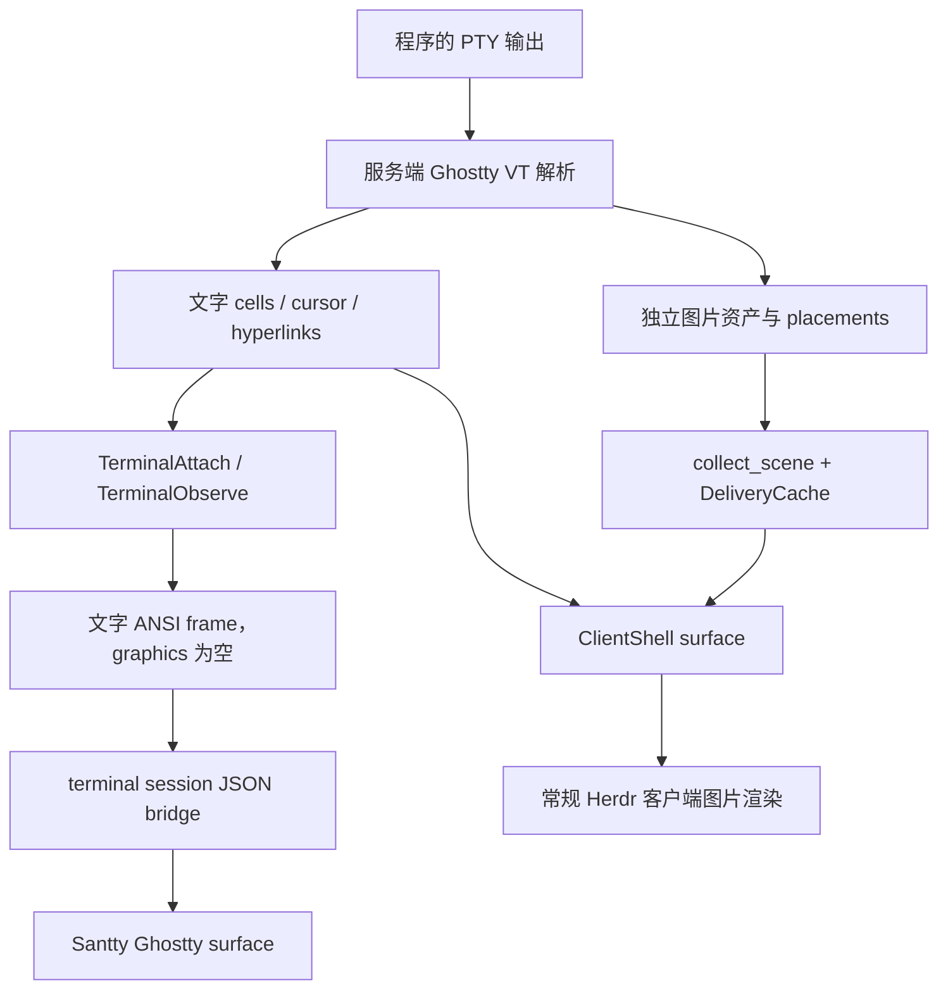

# Herdr 模式图片缺失调查

日期：2026-10-11。安装的 Herdr 为 0.9.3；调查源码基线 `2563803dca97c040beaf3dc3acdcb5a3221b4238`，protocol 22。

## 结论

当前接入使用 `herdr terminal session control/observe` 的单终端 JSON bridge。这个路径不是原始 PTY 输出，也不是 Herdr 常规 UI 的完整图片场景协议。至少有两处确定的图片缺口：

1. 服务端的 `TerminalAttach` / `TerminalObserve` 渲染分支只把文字网格、cursor、hyperlinks 转成 `FrameData`，图片列表为空，没有收集 runtime 内的图片资产和 placement。
2. CLI bridge 只导出 `Terminal` 和 `ServerShutdown`，明确丢弃独立 `Graphics`，其他消息也忽略，包括 `GraphicsFile` 等图片传输消息。

因此，Ghostty 支持 Kitty graphics，并不能让丢失的数据在 Santty 中重新出现。当前问题不是 fish loading，也不是普通 ANSI/base64 解码损坏。只在 Swift 中增加一个图片消息分支，无法补齐服务端未导出的图片状态。

早期计划已记录“桥接忽略独立 Graphics，不能承诺图片协议完整支持”；此前没有进行图片专门验收。本次把这个限制落实为可重复的实际二进制差分和原生解析测试。

## 调查记录

### 1. 真实安装 CLI，隔离 socket 回放

调查时创建临时 protocol-22 socket，只运行安装二进制的 terminal session 客户端，不启动 Herdr 服务，不连接真实 socket，不向已有终端输入或调整尺寸。配置及日志目录也位于临时目录。

向客户端发送同一段 1×1 RGBA Kitty 图片序列，分别放入独立 `ServerMessage::Graphics` 与 `ServerMessage::Terminal.bytes`。前后文字标记和 seq 完整，退出码为 0。

| 客户端模式 | 图片放入位置 | CLI 输出是否保留图片 bytes |
| --- | --- | --- |
| Observe | 独立 Graphics | 否 |
| Observe | Terminal.bytes | 是，逐字节相同 |
| Control | 独立 Graphics | 否 |
| Control | Terminal.bytes | 是，逐字节相同 |

两次运行结果一致。握手 bytes 为 `[0, 22, 80, 24, 0, 0, 0]`，对应 TerminalHello、版本、行列、零像素 cell 尺寸及 pixel_mouse=false。

这证明独立图片消息确实在实际 CLI 中丢失，不只是根据源码推测。它不证明真实 daemon 的完整图片生命周期；回放服务只有协议消息，没有 PTY、图片存储或恢复逻辑。

### 2. Santty 解码 → Ghostty in-memory

[原生测试](../../Santty/Tests/HerdrPrototypeTests.swift) `testKittyGraphicsPayloadInANSIFrameReachesGhosttyInMemoryParser` 创建真实 Ghostty in-memory surface，把 Kitty 查询 `a=q` 和传输/显示 `a=T` 分别包装为 ANSI/base64 frame，再分段输入 Santty decoder。

- 两个 frame 解码后与原始 Kitty bytes 完全相同。
- Ghostty 对查询及传输均返回对应 image ID 的 `OK`。
- 输入经过当前 Herdr pane 所用的同一 `InMemoryTerminalSession.receive` 路径。

这证明 Santty 保留嵌入 frame 的 Kitty 序列，且 Ghostty in-memory 后端接受图片协议。测试检查协议响应，不将 ACK 等同于实际截图中的正确位置、裁剪、滚动或重连渲染。

FlowDeck，保存目标 My Mac / Debug：该原生测试 1/1 通过（8.80 秒）；既有 fragmented/batched、base64、seq、大小上限和截断协议测试 2/2 通过（5.19 秒）。`git diff --check` 通过。应用运行时代码未改，本轮没有另外重建或重启用户 app。

### 3. 用户提供的真实图片 pane：首次连接与重连

用户在现有服务中准备好显示图片的 pane 后，读取 `session.snapshot` 定位到当前 `w5:pA`（tab `w5:t4`，runtime `term_65d8e47a6d4ead`），标题为 `Yazi: Downloads`。使用原有 289×77 网格进行以下只读探测，未发送输入、Resize、ControlTerminal 或 takeover：

1. 直接连接 client socket，按 protocol 22 发送 TerminalHello，然后发送 ObserveTerminal。握手成功后每次观察 2 秒，断开并重新连接，共两次。
2. 通过安装的 `herdr terminal session observe` 对同一 runtime、同一网格再连接两次，每次观察 2 秒，只终止此次启动的 observer 进程。

四次连接均收到 seq=1、full=true 的首帧，解码后为 44,513 bytes，SHA-256 完全相同。直接 socket 在观察期间只有 `ServerMessage::Terminal`（tag 1），没有 `Graphics`、`GraphicsFile` 或其他消息；帧内 Kitty APC、iTerm2 OSC 1337 和 DCS 序列计数均为零。CLI 导出的内容与服务端首帧逐字节对应的 SHA-256 一致。

这把当前用户案例的主要断点定位在 **服务端单终端 Observe 的首帧/重连导出**：绕过 CLI 后仍然没有图片。CLI 丢弃独立 Graphics 是隔离回放已证明的另一个缺口，但这次真实连接中服务端没有发送这类消息，因此不是本次首帧图片缺失的实际发生点。此处没有推断 Yazi 最初采用了哪一种图片传输方式，也不把短时静止画面的观测扩大为全部动态图片生命周期结论。

连接前后快照确认 workspace/tab/pane 焦点、所有布局矩形、目标 pane 的 scroll 信息均未改变。仅保存消息类型、长度、摘要和检查结果，没有保存图片或文件列表内容。

未用常规 ClientShell 做真实图片对照：源码中 `surface_active=true` 的连接会设置 `foreground_client_id`，并参与 tab geometry；`surface_active=false` 则跳过 surface 渲染，只提供 metadata。为了遵守本次只读、不接管和不改变尺寸的约束，没有激活该通道。其图片收集路径的对照目前仍是源码证据。

## 源码中的断点

### 完整因果链：图片存储与文字网格是两份状态

继续追到 PTY 解析层后，原因不是“原来的图片 bytes 被某个 Swift filter 删除”，而是当前接口从一开始就没有导出完整终端状态：

1. `pane/terminal.rs::write_pty_bytes_with_ordered_responses` 把 PTY bytes 交给 `core.terminal.write`；`crates/ghostty-vt/src/lib.rs::Terminal::write` 调用 `ghostty_terminal_vt_write`。图片协议在服务端被解析为 image storage / placement 状态，不会作为原始 PTY 流自动穿过重建后的 ANSI frame。
2. 同一 terminal 明确提供两个不同入口：`render` 遍历 RenderState 的 rows/cells 构造 Ratatui Buffer；`kitty_image_placements_with_data_filter` 则通过 Ghostty graphics placement iterator 独立提取图片位置和按需资产数据。调用前者不等于调用后者。
3. `render_terminal_virtual` 只调用文字 `runtime.render`。TerminalAttach 和 TerminalObserve 共用这个分支，因此缺口不是 Observe 只读策略单独造成的；Control 模式也不会自动补上图片收集。`full=true` 表示 ANSI 文字画面的完整 repaint，不保证包含所有图片状态。
4. ClientShell 的 `render_at` 除文字之外调用 `client_shell_graphics::collect` → `kitty_graphics::surface::collect_scene`。该 collector 查询 authoritative runtime 的 placements，计算 pane 内裁剪、位置与 scroll offset，并用每客户端 DeliveryCache 决定哪些像素资产必须重发。这是普通客户端首次连接能恢复既有图片的具体机制；单终端路径没有对应调用与图片 delivery 状态。
5. 单终端 `FrameData.graphics` 虽然有这个字段，但构造器把它设为空，之后也没有填充。`ClientRenderState::prepare_frame` 原本会把该字段插入文字帧的 synchronized-output end 之前；所以不是 ANSI encoder 天生不能传图片，而是上游从未给它图片内容。

补充：文字渲染中的 `ghostty_buffer_symbol_into` 在 graphics 开启时，会把 Kitty Unicode placeholder `U+10EEEE` 及其组合标记替换为空格。常规客户端随后用独立图片场景覆盖这些位置；单终端路径没有图片层，因此使用 placeholder 的程序会呈现空白区域。上游已有 `render_blanks_kitty_unicode_placeholders_when_graphics_enabled` 测试明确断言这一行为。当前未读取 Yazi 的 adapter 配置或原始输出，不能据此断言此次 Yazi 必然使用 placeholder；它解释的是该机制下空白的来源，关闭 placeholder 隐藏也无法恢复丢失的像素。

对应源码：[PTY 与文字渲染](https://github.com/herdrdev/herdr/blob/2563803dca97c040beaf3dc3acdcb5a3221b4238/src/pane/terminal.rs#L2358)、[独立图片查询](https://github.com/herdrdev/herdr/blob/2563803dca97c040beaf3dc3acdcb5a3221b4238/crates/ghostty-vt/src/lib.rs#L1897)、[场景收集](https://github.com/herdrdev/herdr/blob/2563803dca97c040beaf3dc3acdcb5a3221b4238/src/kitty_graphics/surface.rs#L610)、[ANSI 图片插入点](https://github.com/herdrdev/herdr/blob/2563803dca97c040beaf3dc3acdcb5a3221b4238/src/server/render_stream.rs#L118)。上游测试本轮只阅读，没有运行 Herdr 构建。

### 服务端不是图片完整快照

[headless/render.rs](https://github.com/herdrdev/herdr/blob/2563803dca97c040beaf3dc3acdcb5a3221b4238/src/server/headless/render.rs#L731)中，TerminalAttach / TerminalObserve 调用 `render_terminal_virtual`，再调用 `FrameData::from_ratatui_buffer_with_hyperlinks`。

[protocol/wire.rs](https://github.com/herdrdev/herdr/blob/2563803dca97c040beaf3dc3acdcb5a3221b4238/src/protocol/wire.rs#L793)中，这个构造器设置 `graphics: Vec::new()`。Ratatui cells 和 hyperlinks 无法携带完整的位图资产。

常规 ClientShell 路径不同：`client_shell::render_at` 收集 `SurfaceGraphicsScene`，包含 assets、placements、retained assets，并维护按客户端的 delivery cache。相关实现为 [client_shell_graphics.rs](https://github.com/herdrdev/herdr/blob/2563803dca97c040beaf3dc3acdcb5a3221b4238/src/server/client_shell_graphics.rs) 和 [client_shell.rs](https://github.com/herdrdev/herdr/blob/2563803dca97c040beaf3dc3acdcb5a3221b4238/src/server/client_shell.rs#L442)。这解释了 Herdr 自己能显示图片，但本次选用的单终端接口不能获得同样的内容。

### CLI 丢弃图片消息

[terminal_sessions.rs](https://github.com/herdrdev/herdr/blob/2563803dca97c040beaf3dc3acdcb5a3221b4238/src/client/terminal_sessions.rs#L122)中，`write_terminal_session_output` 把 Terminal bytes 编为 base64 JSON，随后明确执行 `Ok(ServerMessage::Graphics { .. }) => {}`；`Ok(_) => {}` 还丢掉其他未处理消息。

常规客户端 [client/mod.rs](https://github.com/herdrdev/herdr/blob/2563803dca97c040beaf3dc3acdcb5a3221b4238/src/client/mod.rs#L1572)则写出 Graphics bytes，并处理 GraphicsFile、图片传输结果及过期传输。两条路径不是等价接口。此次读取的 upstream master 仍有 Graphics 忽略分支；不能把换到当前 master 视为已确认的修复。

### Santty 当前仅接收终端帧

[HerdrTerminalSession.swift](../../Santty/Sources/Herdr/HerdrTerminalSession.swift)只把 `terminal.frame` 交给 receive。未知 JSON 消息目前忽略，但上游 bridge 还没有导出对应图片 JSON，因此这里不是主要的数据丢失点。

[TerminalPaneController.swift](../../Santty/Sources/Workspace/Panes/TerminalPaneController.swift)直接调用 `memory.receive(data)`，不把画面转成字符串、不去除 APC；native 测试已验证这条解析路径。

## 为什么改 TERM 或转发原始输出不足以解决

- 设置 TERM_PROGRAM、Kitty graphics 配置或初始像素尺寸，不会让当前 TerminalAttach/Observe 分支自动收集图片场景。
- 当前初始握手像素尺寸为零，是应补齐的几何信息；但它不是 CLI 丢弃 Graphics 或服务端构造空 graphics 列表的原因。
- 重连所需的是当前图片资产和位置，不只是从此刻开始转发新的 PTY bytes。直接旁路 PTY 输出会与 Herdr 重建的文字画面冲突，也不能恢复已经显示的图片。
- 当前 `pane.graphics.info/set/clear/stream` API 已撤销，在 [api/server.rs](https://github.com/herdrdev/herdr/blob/2563803dca97c040beaf3dc3acdcb5a3221b4238/src/api/server.rs#L280)明确返回 unknown_method，不能通过这些旧 JSON 方法读取 runtime 图片。
- 大图片还有协议上限不一致：Herdr graphics frame 最大 32 MiB，Santty JSON line 当前上限 4 MiB。图片通路补齐时需要明确分块及总内存预算，不能单纯无限提高限制。

## 合适的修复方向

优先让上游单终端接口提供完整图片输出，继续保留当前原生布局架构：

1. 在 direct terminal 渲染分支收集对应 runtime 的图片场景，维护每客户端 image ID、资产缓存和 placement，包含首次连接与重新连接的完整重放。
2. CLI 导出图片数据、placement/deletion 和传输生命周期。若可复用有序 Terminal frames，优先把 Kitty 控制序列纳入同一帧顺序，避免并行图文通道出现先后错乱；分块必须有明确协议语义。
3. 对 GraphicsFile 处理文件归属、长度、生命周期、传输开始/结果/过期确认；或者使用有边界的 inline 传输，不能直接信任任意路径并读文件。
4. Santty 按接口保证顺序交给 Ghostty，提供像素 cell 尺寸、分块预算和重连清理。补首帧图片、图片后续替换/删除、resize、裁剪、滚动、浮动、隐藏、重连与 Observe 多客户端验收。

如果必须使用未修改的当前服务，另一个方向是实现已有 generation-1 ClientShell endpoint/surface/blob 通道，把提供的图片场景映射到 Ghostty。它目前带完整 tab surface、pane geometry 和资源生命周期，不能假定能直接作为多个独立 per-pane viewport 的替代；需要单独做接口验证。不要复制完整私有 protocol-22 二进制客户端作为临时补丁。

用户约束是只做外部接入。因此实际后续选择应优先验证上述 ClientShell 通道：保留 Santty 原生 tab、pane 和本地辅助功能，把服务端 tab surface 按其 pane geometry 分配到对应的 Ghostty surfaces，并同时映射图片资产与 placements。这属于画面传输接口的调整，不能用一个 TERM 配置、CLI 参数或 Swift 图片分支完成。ClientShell surface 的激活、前台身份、尺寸所有权及图文原子更新需要一起验证；当前尚未证明这种分配能完整满足独立 pane 尺寸与多客户端行为。上游补齐单终端接口仍是可选方案，但不符合“仅修改 Santty”的实施范围。

本轮没有修改安装的 Herdr、启动服务、结束终端或改变现有连接模式，也没有宣称图片显示已修复。已确认 Kitty inline 原生解析路径，并在用户当前 Yazi 图片 pane 上复现 Observe 首帧/重连缺少图片数据；Sixel、iTerm2、常规 ClientShell 的实际截图和完整图片生命周期尚未逐一验证。
