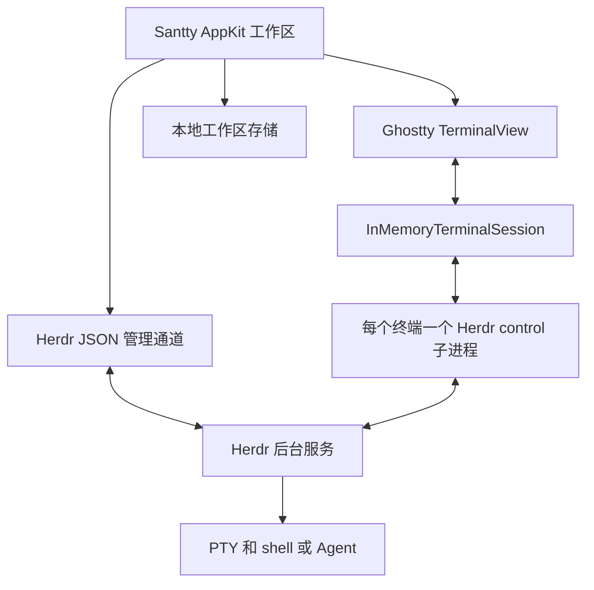

# Santty 接入 Herdr 的原生客户端实施计划

2026-10-11 后续主线：为补齐图片和常规客户端语义，完整窗口 Control 模式拟迁移到 ClientShell 协议，见 [ClientShell 调查与迁移计划](herdr-clientshell-migration.md)。新计划尚未实施；本文件记录既有 direct 接入阶段，Observe 与单 pane direct 暂保留现有通道。

日期：2026-10-10  
状态：增加完整窗口 Herdr 布局镜像及右下角 workspace 切换；阶段 0 外部接入验证完成，结论为调整后继续；阶段 1 通信与生命周期、阶段 2 原生工作区接入完成；阶段 3 持久化与恢复及原生退出/强制结束/重开验收完成；阶段 4 现有能力适配完成（最近历史快照契约）；阶段 5 外部接入 Beta 实现与当前机器验证完成，正式发布门槛仍待验证；阶段 6 按用户 2026-10-11 指示暂缓（暂时跳过 SSH）。  
目标：保留 Santty 的原生 UI、快捷键、Ghostty 渲染和混合工作区，让 Herdr 托管终端进程，使退出 Santty、客户端崩溃或连接中断后仍能重新连接原终端。

## 1. 产品范围与成功标准

用户可以用 Santty 的菜单、Command 快捷键和鼠标创建、切换、调整终端，不需要使用 Herdr prefix。终端可以与 Browser、Notes、浮动 pane 共存。关闭 Santty 只断开客户端；重新打开后恢复本地布局并连接仍在运行的终端。

“恢复”分为两种，UI 和测试必须区分：

- Herdr 服务仍在运行：重新连接原来的进程、终端状态和历史。
- Herdr 服务或机器已经重启：重新发现 Herdr 恢复的布局和 Agent 会话；原进程不再存活，不声称恢复了原 PID 或任意程序的运行状态。

第一版交付本地 Herdr 支持，作为可选择的终端模式。现有本地终端继续可用；已有 shell 不能透明迁移给 Herdr，用户在新建终端时选择持久会话。

后续阶段增加 SSH 远端。第一版不做多端同时写同一终端、完整 Herdr TUI 复刻、tmux/Zellij 多后端框架、Herdr 插件市场、自动重启任意命令或云端服务。

完整验收标准：

1. 两个原生终端 pane 独立输入、独立 resize，运行 shell、Vim 和至少一种常用 Agent 正常。
2. 退出或强制结束 Santty 后，隔离测试服务中的长任务继续运行；重开后连接同一终端。
3. 原生分屏、浮动、隐藏 pane、Browser、Notes 和原有快捷键没有回归。
4. 重连不会重复创建 pane、重发输入、自动抢占其他控制者或错误终止后台任务。
5. 历史读取、搜索、Agent 状态、cwd 和进程信息从正确的数据源取得。
6. 连接失败、服务退出、终端结束和控制权被抢占能够明确区分。

## 2. 已确认的接口与依据

### Herdr

调研基线为 Herdr 0.9.3，源码提交 `2563803dca97c040beaf3dc3acdcb5a3221b4238`。实现时固定并验证一组客户端与服务端版本，不把版本号相近当作兼容保证。

- 管理通道：Unix socket 上的逐行 JSON，请求有 ID，支持会话快照、workspace/tab/pane 操作、Agent 状态和事件订阅。
- 终端通道：`herdr terminal session control <target>` 输出包含 base64 ANSI 数据的 `terminal.frame`，stdin 接收输入、resize、滚动、鼠标和 release。
- 一个终端只能有一个可写 direct controller；多个只读 observer 可以同时观察。接管需要明确使用 takeover。
- 终端桥接输出是服务器重建的画面，不等于原始 PTY 输出。当前桥接源码忽略独立 Graphics 消息，不能承诺图片协议完整支持。
- 图片专门调查与实测见 [Herdr 模式图片缺失调查](herdr-images-investigation.md)：单终端服务端没有导出完整图片场景，已安装 CLI 丢弃 Graphics；同一图片在 Terminal.bytes 内可保持字节并获 Ghostty in-memory 协议确认。当前缺口仍未修复。
- 稳定 endpoint generation 与 direct-terminal 内部二进制协议是不同的兼容边界；采用 CLI 桥接，避免在 Swift 中复制私有二进制协议。

依据：[Socket API](https://herdr.dev/docs/socket-api/)、[终端连接文档](https://herdr.dev/docs/persistence-remote/#direct-terminal-attach)、[桥接源码](https://github.com/herdrdev/herdr/blob/2563803dca97c040beaf3dc3acdcb5a3221b4238/src/client/terminal_sessions.rs)、[协议兼容边界](https://github.com/herdrdev/herdr/blob/2563803dca97c040beaf3dc3acdcb5a3221b4238/src/protocol/endpoint.rs)。

### Santty 与 Ghostty

当前 `TerminalPaneController` 使用默认 `.exec` 后端，每个视图由 Ghostty 创建子进程；cwd 和 Agent 存活检查依赖本地前台 PID。`WorkspaceTabState` 保存内存中的布局和 pane controller；目前不能将其视为已存在的完整磁盘会话恢复机制。

仓库中的 libghostty-spm 已提供所需的 host-managed I/O：

- `TerminalSurfaceOptions(backend: .inMemory(session))`。
- `InMemoryTerminalSession(write:resize:)` 接收终端生成的输入和尺寸变化。
- `session.receive(Data)` 将外部输出送入 Ghostty。
- `InMemoryTerminalViewport` 提供行列数及像素尺寸。

因此主线直接使用现有 Swift API，无须先修改或重新编译 Ghostty C 核心。接口存在已确认，实际 ANSI 兼容性和输入语义仍需阶段 0 验证。

本地依据：`Scripts/prepare-ghostty.sh` 固定的 revision `b0930320739324886590e865d571eb5dd7073912`，以及 `Vendor/libghostty-spm/Sources/GhosttyTerminal/InMemory/`、`Surface/TerminalSurfaceOptions.swift`、`Controller/TerminalController+Surface.swift`。

## 3. 架构与状态归属



| 状态 | 权威来源 | Santty 的责任 |
| --- | --- | --- |
| PTY、shell、Agent 进程和退出状态 | Herdr | 连接、展示，按明确指令结束 |
| 终端画面、历史、滚动位置 | Herdr | 用 Ghostty 展示，正确转发滚动 |
| 原生 pane 尺寸 | Santty 当前可见视图 | 给对应 controller 发送实际行列数 |
| Browser、Notes、本地辅助树、浮动/隐藏与自动放大 | Santty | Herdr 树外围的本地区域及本地显示状态；独立持久化 |
| Herdr workspace/tab/pane、分屏树和 zoom | Herdr | 完整窗口模式按权威快照投影原生 UI |
| 焦点与选中标签 | Control: Herdr；Observe: Santty | Control 写回后端；Observe 本地浏览 |
| Herdr 终端 Agent 状态、cwd、PID | Herdr | 映射到现有展示模型，避免本地 PID 猜测 |

2026-10-11 根据用户的新要求增加完整窗口 Herdr 模式：Herdr 是 tab 顺序、pane 成员、二叉分屏方向/比例及 zoom 的唯一权威。Santty 使用 `session.snapshot` 和逐 tab `layout.export` 校验完整投影后更新原生视图；后台事件使投影失效，刷新期间的新事件会触发下一轮刷新。未变化的 pane/controller 保留 UUID 和连接。外部新增、删除、重排和分屏变化自动同步。

右下角原生 workspace 下拉组件显示当前 workspace 名，支持切换及退出 Herdr 模式。进入前的本地 tabs 暂停显示并保留。模式内 Notes、Browser 与本地终端使用 Herdr 树右侧的本地辅助树，支持本地分屏、移动、浮动/隐藏及自动放大；终端浮动或隐藏保留 Herdr 树占位。后端快照只替换 Herdr 树，本地辅助状态按 endpoint、服务身份、workspace/tab ID 关联，切 workspace 时保留。聚焦辅助 pane 不写后端焦点，延迟回复或外部焦点变化不抢走正在使用的辅助 pane；返回 Herdr terminal 后同步。后端 tab 消失时辅助内容转为普通本地 tab，通过 Leave Herdr Mode 访问；退出模式时所有辅助内容保留为本地 tabs。

Control 模式将 tab/pane 焦点、tab 重排、原生 divider 拖动写回 Herdr，再刷新权威布局；创建/结束操作也按后端快照导入。结束 pane/tab 明确确认会结束后端进程，关闭窗口或退出模式只释放连接。Observe 模式允许本地选 tab/pane 和 workspace，禁止布局/焦点写回。完整窗口模式和当前 workspace 身份、只读模式、暂停的本地 tabs 及其他 workspace 的本地辅助状态一起持久化。工作区格式升级 v2，继续读取 v1，旧版拒绝覆盖 v2；恢复前仍核对服务及 runtime 身份。

阶段 0 已验证独立 controller resize；实际可见视图尺寸仍分别传给每个 Control bridge，Observe 不改后端 viewport。Herdr 全局布局比例与每个 controller 的实际行列数是两个不同的协议状态。

## 4. 最小模块与现有改动范围

新增代码集中在 `Santty/Sources/Herdr/`，按实际职责逐步拆文件，不先建立通用 multiplexer SDK。

| 模块或现有文件 | 计划责任 |
| --- | --- |
| `HerdrConnection` | 可执行文件、session/socket 定位，管理请求、订阅、能力与重连 |
| `HerdrTerminalSession` | 一个 control 子进程的 stdin/stdout/stderr、帧解析、输入顺序、生命周期 |
| 最小 Codable 消息类型 | 只覆盖使用到的请求和响应；保留未知字段兼容，不生成全部上游 schema |
| `TerminalPaneController` | 选择 `.exec` 或 `.inMemory`，接入连接状态、输入输出及真实后端元数据 |
| `WorkspaceViewController` | 创建、关闭、连接与恢复操作；异步后端失败时保持一致的 UI |
| `WorkspaceTabState`、`LayoutNode` | 持久化所需的纯数据映射；不编码 controller 或 NSView |
| `AppDelegate` | 启动恢复、退出前保存、释放客户端；保留 Notes 保存流程 |
| `AgentSessionStore` 与现有 Agent 监控 | 后端状态映射、通知去重，按终端来源选择监控方式 |
| `CLIControlServer`、`CLIProtocol`、`CLITextSnapshot` | 兼容现有 list/read/search，改用权威历史数据与后端进程信息 |
| 设置、菜单、命令面板 | 持久终端入口、连接状态、断开与结束操作 |
| `Santty/Tests/` | 协议、生命周期、布局恢复、CLI 与 Agent 回归测试 |
| `README.md`、打包配置 | 配置、使用、版本兼容与分发说明 |

优先保留 `TerminalPaneController` 这一公共入口，避免让现有大量具体类型调用失效。引入新的 pane controller 类型之前，先枚举 `terminalPaneController(for:)`、类型转换、快捷键、提示编辑器、滚动模式和 CLI 的全部调用方，证明拆分确实减少复杂度。

所有 AppKit 变更保持 `@MainActor`。socket、管道读写、JSON/base64 解析在非主线程执行。沿用 Ghostty 的线程安全 `receive` 通道；显式保证 surface、session 和子进程释放顺序，拒绝旧连接的迟到回调。

## 5. 两条通信通道的契约

### 管理通道

1. 显式指定专用 named session，不依赖用户的默认 Herdr session 或继承环境中的 socket 路径。
2. 使用结构化 JSON 编码请求，ID 唯一，限定超时与消息大小；不拼接 shell 命令。
3. 初始启动先建立事件订阅，再获取 `session.snapshot`。事件只使相关缓存失效，通过权威查询重新核对；不能把旧事件无条件重放到新快照上。
4. 处理未知字段、unsupported method、事件丢失和订阅 EOF。事件丢失或重连后重新获取快照。
5. 创建/关闭超时视为“结果未知”，先查询服务器状态。禁止直接重试非幂等操作而重复创建终端。
6. 请求队列按同一资源串行；UI 不阻塞等待网络。日志默认仅记录方法、ID、错误和耗时，不记录终端内容或粘贴文本。

### 终端通道

使用 `Process` 的 executable URL 与 arguments 启动固定的 Herdr binary，并保持三条管道分离。命令行形态以目标版本 CLI 验证结果为准：

```sh
herdr --session santty terminal session control <terminal_id> --cols 120 --rows 40
```

- stdout 只按换行解析 JSON；允许一次读取半条或多条消息，限制单条长度和累计缓存，校验 base64、尺寸和事件类型。
- `terminal.frame.bytes` 解码为 `Data` 后按顺序传给 `InMemoryTerminalSession.receive`，不先转成字符串。
- surface 就绪后才开始送帧；重连使用新的连接代次及完整初始画面。不能向已经销毁或绑定到其他终端的视图写入旧帧。
- 记录 `seq` 和 `full`；增量帧不能随意丢弃、乱序或只保留最后一帧。发现缺口/队列超限时暂停交互并重新连接获取完整画面。
- 验证 `receive` 内部队列的积压可观察性。若无法证明持续输出时内存有界，阶段 0 不通过；先选最小流控或 Swift 层接口修正，不能靠无上限缓存掩盖。
- Ghostty `write` 回调生成 `terminal.input` 的 base64 bytes，保留原始字节。只在已获得控制权且连接就绪时接受输入；断线输入不缓存、不自动重放。
- viewport 回调生成 `terminal.resize`，去重并合并尚未发送的 resize，带上 cell 像素尺寸；隐藏视图不发送零尺寸，不因布局销毁而关闭 runtime。
- stderr 独立消费，避免管道阻塞；解析错误、EOF、非零退出和 `terminal.closed` 都必须处理。
- `terminal.release`、关闭 stdin、回收子进程只释放客户端。必要时结束卡住的桥接进程，不调用 `server.stop` 或 `pane.close`。

输入兼容性是独立验收项。Herdr 输出的是重建画面，不能假定它同步了原应用所有键盘、鼠标、bracketed-paste、focus 和查询响应模式。阶段 0 要验证这些模式，并确认 Ghostty 自动生成的终端查询回复不会被当作用户输入错误转发或形成回路。

鼠标和滚轮只能选择一个转发入口：优先使用 Herdr 的语义 `terminal.mouse`/`terminal.scroll` 并保留本地文本选择。如果 Ghostty 也产生鼠标字节，必须阻止同一事件重复发送。坐标基准、修饰键位和像素到字符格换算从目标版本源码及测试确认。

## 6. 生命周期与用户操作

连接状态至少区分：未连接、连接中、可交互、只读、重连中、终端已结束和错误。沿用现有 UI 展示，不以一个 `isLive` 布尔值同时表达连接状态与后台进程状态。

| 用户操作或事件 | 后端行为 | UI 行为 |
| --- | --- | --- |
| 退出 Santty 或关闭主窗口 | 释放 controller，保留 Herdr runtime | 保存工作区；Notes 仍完成保存或取消退出 |
| 断开终端 | release，不关闭 pane | 显示可重新连接的占位视图 |
| 从布局移除但保留任务 | release，保留 runtime | 移除本地引用；仍可从会话列表找到 |
| 结束终端 | 明确执行 `pane.close` | 确认影响后结束；成功后移除或保留退出画面 |
| 关闭包含运行终端的 tab | 显示“移除视图并保留任务”与“结束终端” | 默认保留任务，避免继承当前销毁视图即结束的语义 |
| 已有其他 controller | 默认连接失败或只读观察 | 展示“接管”操作，不自动传 `--takeover` |
| 本客户端被接管 | 停止发送输入、释放旧连接 | 标为只读/已断开，禁止自动反抢 |
| 连接断开 | 查询存活状态，有限退避重连 | 保留最后画面并明显标识不可交互 |
| 后台终端结束 | 不自动重启用户命令 | 标为已结束；新终端是独立操作 |
| 服务重启 | 重取快照、验证身份映射 | 不能直接把旧 pane ID 绑定给新对象 |

现有 Santty 的 `detachPane` 是本地布局中的隐藏/收纳功能，与 Herdr 的连接断开不是同一操作。保持其现有布局语义；是否释放不可见 controller 只影响资源策略，不应使隐藏 pane 消失或结束。

## 7. 标识、持久化与恢复

使用独立的纯数据工作区文件，schema 带版本，原子替换写入并保留最后一份有效备份。存储窗口、tab、布局树、浮动/隐藏信息、Browser URL、Notes 文档引用和终端绑定；不存储 NSView、controller、SSH 凭据或终端内容。

终端绑定至少包含本地 PaneID、endpoint/session 标识、Herdr workspace/tab/pane ID、terminal ID，以及能区分服务重启或对象重建的身份信息。具体上游字段由阶段 0 核对；不能假设 JSON 管理快照一定有 stable endpoint 的 `boot_id`。若缺少可靠的跨重启身份凭证，只自动恢复同一存活服务；冷启动要求重新核对/选择，禁止按短 pane ID 猜测。

恢复顺序：

1. 读取并验证工作区文件；损坏时保留原文件，使用备份或显示可恢复错误。
2. 创建本地布局和连接占位视图，不立即启动新 shell。
3. 查询 Herdr 的权威快照并核对终端身份。
4. 连接现存终端，取得完整画面后启用输入。
5. 缺失对象显示“终端不存在”，由用户决定移除或新建；不自动重跑保存的命令。
6. UI 状态变更采用短延迟合并保存，退出前完成必要写入；关闭 Notes 的取消操作不能提前销毁终端视图。

多 Santty 实例不能同时覆盖同一工作区文件。第一版按实例/工作区明确所有权，冲突时拒绝第二个写者；连接同一终端的竞争按 Herdr controller 规则处理。

## 8. 历史、CLI、Agent 与环境

### 历史与 CLI

Herdr ANSI 帧只负责显示，Ghostty 本地缓冲区不再是整个 shell 历史的权威副本。持久终端的 read/search 使用 Herdr `pane.read` 的合适 source，再复用 `CLITextSnapshot` 做现有范围和搜索处理。

阶段 0 比较 visible、recent、recent-unwrapped 的换行、软换行、截断与最大可读历史。若上游不能提供现有 CLI 所承诺的完整范围和行号，明确返回能力限制，必要时升级 CLI 协议；不得用重绘帧拼出伪历史或返回错误的 totalLines。

本地 UUID 继续作为 Santty CLI 的 pane 标识。cwd、前台进程组和进程列表使用 Herdr 的真实 runtime 数据；缺失则返回未知，不暴露桥接子进程 PID 作为 shell PID。远端阶段还必须避免把远端 PID 交给本地进程检查器。

滚动模式要接 Herdr 的历史滚动，不复用会直接滚动 Ghostty 本地缓冲区的实现。当前可见文本选择可以复用；跨历史选择、搜索命中跳转及复制单独验收。未达到原语义前，用明确的能力状态禁用相关入口，不能悄悄显示错误结果。

### Agent 状态与通知

保留现有 Agent 管理视图。`.exec` pane 继续使用本地 hooks/进程监控；Herdr pane 使用 Herdr 状态与事件，映射到运行、等待用户、完成和结束。

Herdr 的 idle/unknown 不直接等价于 Santty 的“任务完成”。用明确事件或已验证的状态转换生成完成通知；重连快照不补发一轮旧通知。按终端身份和会话/事件信息去重，避免 Herdr 与 Santty hooks 双重通知。无 Agent 标签的普通 shell 仍是正常终端。

创建后端 shell 时传递所需 cwd 和明确的环境。当前 `SANTTY_CONTROL_SOCKET`、`SANTTY_AGENT_SOCKET`、`SANTTY_RUNTIME_OWNER` 指向 GUI 实例，GUI 重启后会过期；不能把这些变量原样固化进长期存活的 shell。第一版 Herdr pane 不依赖旧 hooks，Santty CLI 通过可验证的 session/terminal 映射发现当前 GUI；GUI 不在时明确报告不可用。远端 shell 不注入本地 socket 路径。

## 9. 交付阶段与验收门槛

### 阶段 0 单终端技术原型

用户随后限定“Herdr 已单独启动，只做外部接入”。阶段 0 因此使用已授权的现有终端，不创建隔离服务，不重启服务或新建 pane；验证对象为 `w5:p2`，`w5:p1` 仅用于尺寸。服务重启和创建幂等性通过接口审阅划定边界，不标为现场测试通过。

- [x] 固定 Herdr 0.9.3 测试基线，记录 CLI/server 版本、协议信息、binary hash 和已授权的外部 session。
- [x] 用当前 `InMemoryTerminalSession` 接通单个 `terminal session control`，完成输入、输出、尺寸、release 和重新连接。
- [x] 确认完整初始画面、光标、颜色、alternate screen、查询回复和输入模式的实际行为。
- [x] 验证 CJK/emoji、IME 组合/提交接口、Ctrl/Cmd/Option、方向键、Shift+Enter、多行 bracketed paste、Vim 鼠标和滚轮；确认正式粘贴必须走语义 API。
- [x] 扩展到同一后端 tab 的两个 controller，验证尺寸隔离、Herdr TUI 并存、writer 冲突及仅接管测试自己的 controller。
- [x] 验证 12,000 行持续输出、frame 队列、内存和主线程响应；同一 surface 重连无需重建。
- [x] 验证历史读取限制与同一服务内 ID 重连；审阅冷启动身份和创建结果未知的边界，禁止未经验证的自动恢复或盲目重试。
- [x] 保留协议及 native 测试、输入/压力夹具、外部检查脚本和机器可读结果，结论为调整输入/历史契约后继续；组合运行的现有滚动选择测试风险仍需排查。

通过条件：无需修改 Ghostty C 核心即可稳定交互；至少 shell、Vim 和一个常用 Agent 的基本操作正确；没有输入重复、终端内容回流、尺寸互相覆盖或无界内存增长。

失败处理：先定位为薄桥接问题还是 Herdr 的协议缺失。允许小范围 Swift 接口适配；若需要重建终端状态同步、长期维护 Herdr fork 或改 C 核心，停止主线，重新比较 tmux control mode。`terminal attach` 可用于定位/演示，但不能替代上述验证后宣布正式接入完成。

### 阶段 1 通信与连接生命周期

- [x] 实现管理通道、最小消息类型、终端管道和连接状态机。
- [x] 完成 EOF、stderr、异常退出、超时、未知消息、失效连接代次与有界缓存处理。
- [x] 支持显式连接/断开、只读及手动 takeover；释放资源后无桥接进程泄漏。
- [x] 版本不兼容时保留后台服务和任务，给出可操作错误；不自动升级或停止服务。

验收：协议测试覆盖拆包/粘包、错误 base64、尺寸越界、序列异常、重连和关闭竞争；模拟写入失败不重复发送输入。

15 项相关测试全部通过，外部服务与终端身份保持不变。

### 阶段 2 原生工作区接入

- [x] 增加新建持久终端和连接现有终端入口，使用现有设置/命令面板模式。
- [x] 将分屏、重命名、关闭、tab 操作接入后端，处理失败与结果未知。
- [x] 保持 Browser、Notes、浮动、自动缩放、隐藏 pane 的本地布局逻辑。
- [x] 统一菜单、快捷键和关闭按钮中的“断开”“移除视图”“结束终端”语义。
- [x] 先让后端创建成功再提交正式 pane；失败可移除加载占位，不删除已有对象。

验收：混合 pane 的所有主要布局操作保持正确；外部新增/关闭终端不会损坏本地布局；关闭窗口后隔离测试长任务仍存活。

105 项相关测试通过；修改操作与长任务退出使用隔离服务夹具验证，真实现有服务只验证已授权连接，不宣称真实服务创建/销毁测试已完成。

### 阶段 3 持久化与恢复

- [x] 增加版本化工作区文件、原子保存、备份读取及多实例写入保护。
- [x] App 启动恢复占位布局，查询后连接；App 退出只保存并释放连接。
- [x] 覆盖 Notes 取消退出、GUI 强制结束、隔离服务重启、对象缺失、ID 重用与工作区文件损坏。
- [x] 新建持久终端为显式选择；不转换正在运行的本地 `.exec` shell。

验收：正常退出和强制结束 Santty 后恢复同一仍存活的终端；服务冷启动不会把旧绑定错误连接到另一终端，也不会重复执行用户命令。

Notes 取消、服务更换、对象缺失/ID 重用及文件损坏通过隔离测试；可用显示器恢复后，以独立 bundle 完成正常退出及强制结束后恢复同一真实终端，并修复空闲 Observe 子进程退出清理。

### 阶段 4 现有能力适配

- [x] read/search/list、进程信息、cwd 继承改用正确后端。
- [x] 接通冻结最近历史的滚动、选择、复制；接通 Control 提示编辑器、多行粘贴和终端设置变化。
- [x] 接通 Agent 状态、未读标记与通知去重；拆开本地 liveness 监控和后端状态。
- [x] 解决持久 shell 内 Santty CLI 的实例发现及环境变量过期问题。
- [x] 对图片、跨历史选择等尚未满足的能力明确展示限制，记录是否阻止正式发布。

验收：现有相关测试通过；两个模式下 CLI 输出遵守各自公开契约；一个完成事件最多产生一次通知。

Herdr 0.9.3 只提供最近最多 1000 行文本；不等同完整历史滚动，CLI 行号相对于当前快照。图片、实时跨历史选择及精确 Vim motion 尚不支持，阻止作为无能力限制的默认终端模式正式发布；保留显式实验入口。

### 阶段 5 本地 Beta 与发布

- [x] 首版使用用户安装、已验证版本的 Herdr，通过明确路径发现；Finder 启动时不能依赖交互 shell 的 PATH。
- [x] 按用户“已单独启动 Herdr，只做外部接入”的约束，连接明确指定的现有 session/API socket；不创建 session、不启动后台服务，也不隐式选择其他 session。用户已选择 default 时允许接入该现有服务。
- [x] 增加诊断信息：Santty/Herdr 版本、session、连接状态、最后错误类别；默认不包含终端文本或原始后端错误。
- [x] 通过 FlowDeck 完成当前 arm64 / macOS 27.0.1 上 Debug/Release 构建与相关测试；deployment target 保持 macOS 14.0。
- [ ] 完成 macOS 14 和 Intel 的实际运行验证，不能用 deployment target 或当前机器构建代替。
- [x] 完成可选择的外部本地实验模式与诊断 UI；记录隔离 1/8/16 视图输出、隐藏/resize、100 次连接释放及真实 Observe 初始帧基线。
- [ ] 完成正式发布矩阵：真实独立 1/8/16 runtime、三种客户端输入到像素/CPU/RSS对照、实际 DPI/休眠唤醒、支持系统覆盖；再决定发布。
- [x] 更新 README、快捷键说明、已知限制、Herdr 版本兼容和恢复/退出说明。

本轮不宣称完整正式发布验收已完成，没有上传发行版或更新 appcast。

首版不自动下载、升级或内嵌 Herdr。若后续需要开箱即用分发，另做固定资产校验、架构支持、许可证/NOTICE、签名、公证和更新策略；升级应用不得隐式停止正在运行的 Herdr 服务。

### 阶段 6 SSH 远端

状态：按用户 2026-10-11“暂时跳过 SSH”的指示暂缓整个阶段，不加入 SSH 传输/远端 endpoint 代码，也不进行真实远端连接。以下条目保留为后续计划；当前交付范围继续为已有本地 Herdr 服务的外部接入。

在本地版本通过验收后单独实施，不作为本地版本的前置条件。

- [ ] 使用系统 OpenSSH 与现有认证配置；终端 NDJSON 通道使用无 PTY 的 SSH stdio，保证 JSON 不被登录输出污染。
- [ ] 在远端调用与运行服务兼容的 Herdr CLI；验证管理通道的公开转发方式，不自行暴露公网 TCP socket。
- [ ] 校验 host key、认证失败、休眠唤醒、超时、网络抖动和重连；不关闭 host key 检查，不自动修改远端安装。
- [ ] endpoint 身份包含主机与 session，所有 ID/PID 按 endpoint 隔离。
- [ ] stdin 断线时不缓存并重放按键，创建/关闭结果未知时先查询确认。
- [ ] 明确远端 Browser URL、文件路径、剪贴板和 Agent 通知的本地/远端语义。

验收：断开 SSH 后远端任务继续，重连回到同一终端；错误主机、失效凭据和版本不兼容不会影响本地终端或其他 endpoint。

## 10. 验证矩阵与性能标准

| 类别 | 必测场景 | 通过标准 |
| --- | --- | --- |
| 输入 | ASCII、中文 IME、emoji、组合键、Shift+Enter、多行粘贴 | 无丢字、重复、错误提交或控制序列泄漏 |
| 终端状态 | Vim/less、alternate screen、光标、颜色、查询响应 | 初始连接与重连后画面和交互正确 |
| 鼠标和历史 | Vim 鼠标、滚轮、历史滚动、文本选择、复制 | 一次事件只处理一次；不误输入到程序 |
| 几何 | 两 pane、不同比例、浮动、字体/DPI 变化、隐藏后重显 | 行列匹配，尺寸不互相覆盖 |
| 生命周期 | 正常退出、GUI 崩溃、桥接 EOF、服务退出、terminal 退出 | 状态可区分，后台任务不被意外结束 |
| 控制权 | 两客户端竞争、observe、takeover、旧连接迟到事件 | 默认不抢占，不形成相互重连抢占循环 |
| 数据一致性 | 订阅丢失、快照竞争、创建超时、ID 重用、损坏存储 | 可重新核对，不重复创建或绑定错对象 |
| CLI/Agent | 范围读取、搜索、cwd、PID、未知 Agent、重连通知 | 数据来源正确，保持协议契约与通知去重 |
| 压力 | 1/8/16 panes，持续日志、频繁 resize、100 次连接释放 | 无泄漏、无无界队列、UI 持续响应 |

在同一台机器记录原生 `.exec`、Herdr 自身客户端、Santty Herdr 模式三组基线。测量输入到画面的延迟、主线程停顿、CPU、常驻内存、每终端桥接进程数和重连耗时。先在阶段 0 固定可重复负载及测量方式，再设发布阈值；不凭未经测量的数字承诺性能。

必须满足的硬条件：持续输出停止后队列能够清空；重复连接释放后资源回到稳定范围；隐藏 pane 数量增加时不持续堆积画面；没有协议解析/同步 I/O 阻塞主线程。若 Ghostty 的现有异步接收无法提供足够流控，必须在扩展到多 pane 前解决。

自动化使用管道/socket fixture 测试故障边界，再用真实 Herdr 的隔离 session 做集成验证。GUI 交互只验证与变更有关的最短路径；不在用户现有后台任务上执行终止、接管或压力测试。

## 11. 发布、回退与停止条件

第一版保留现有本地终端路径，以明确的“本地终端/持久终端”选择逐步启用，不建立泛化后端插件系统。用户可以停止新建 Herdr pane，但切换设置不能销毁已有 Herdr 任务。

回退到旧 Santty 时：Herdr 继续运行，用户可用兼容的 Herdr 客户端连接；保留工作区文件和终端绑定，不做不可逆迁移。应用卸载不隐式删除 Herdr session 或用户的 Herdr 配置。

以下任何一项出现，暂停扩展范围并重新评估：

- 必须重编译 Ghostty C 核心才能实现基本交互。
- 正确输入依赖不完整的模式猜测，导致普通 shell/Vim/Agent 无法稳定使用。
- 同一个终端的尺寸/控制权不能可靠隔离。
- 无法约束输出缓存，或多 pane 性能明显无法达到可用水平。
- Herdr 的公开桥接不能提供产品所需的关键能力，且需要长期维护大规模 fork。

tmux control mode 是重新评估时的备选，不在本计划中同步实现第二套后端。

## 12. 建议提交顺序与完成定义

按依赖顺序提交，每项都应能独立审阅，代码规模允许时合并相邻小项：

1. 单终端技术原型、协议 fixture、兼容性结论。
2. Herdr 管理连接和终端桥接，故障及生命周期测试。
3. `TerminalPaneController` 的 in-memory 接入和原生工作区操作。
4. 工作区持久化、退出/断开/结束语义与恢复测试。
5. CLI、滚动、Agent 和环境发现适配。
6. 本地 Beta 设置、诊断、真实场景验证和使用文档。
7. 本地版本稳定后，独立推进 SSH 支持。

本地第一版完成的定义是阶段 0–5 全部通过，关键限制已落实到行为和文档，并能证明“退出 Santty 后任务继续、重开后恢复”的完整用户流程。计划中的复选框只在有实现或验证证据后勾选；接口调研不等同于功能已完成。
